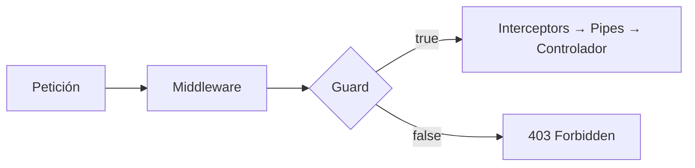

# Guards

<Tech ids={['nestjs']} />

<Estado tipo="construye">Un guard que protege los endpoints internos (los que llama el programador de tareas de Google Cloud) con una clave secreta. La autenticación de usuarios con Better Auth llega en la sección 6.</Estado>

## Concepto

Un **guard** responde una sola pregunta: **¿esta petición puede seguir?**
Devuelve `true` (sigue) o `false` (Nest responde **403 Forbidden**). También
puede tirar su propia excepción, por ejemplo `UnauthorizedException` (401).

Se ejecuta **después de los middleware** y **antes de los interceptors y los
pipes**. A diferencia del middleware, el guard sabe **qué controlador y qué
método** se va a ejecutar, gracias al `ExecutionContext`. Eso le permite leer
metadatos del método (por ejemplo, "este endpoint es público" o "requiere rol
superadmin").



### La interfaz

```ts
export interface CanActivate {
  canActivate(context: ExecutionContext): boolean | Promise<boolean> | Observable<boolean>;
}
```

Puede ser síncrono, una Promise o un Observable: igual que en Angular.

### `ExecutionContext`

Extiende al `ArgumentsHost` que viste en los filtros, y agrega dos métodos clave:

- `context.getHandler()`: el método del controlador que se va a ejecutar.
- `context.getClass()`: la clase del controlador.

Con eso y el `Reflector` se leen los metadatos que pusiste con decoradores
(lo hacemos a fondo en el tema de decoradores propios).

### Dónde se aplica

```ts
@UseGuards(InternalApiKeyGuard)         // en un método o en todo el controlador
{ provide: APP_GUARD, useClass: X }     // global, con inyección de dependencias
```

<Angular>

Es el mismo concepto que `CanActivate` del router de Angular: una función o
clase que decide si se puede entrar a una ruta. En Angular protegés
**pantallas** (y es solo experiencia de usuario, porque el código igual está
en el navegador). En Nest protegés **datos**: este sí es el control de
seguridad de verdad.

</Angular>

## En ripopola: proteger los endpoints internos

Más adelante, **Cloud Scheduler** (el cron de Google Cloud) va a llamar a la
API para cosas como "procesar traducciones pendientes" o "despublicar ofertas
vencidas". Esos endpoints no son para el público: solo los puede llamar quien
tenga una clave.

### 1. La clave en el `.env`

```bash title=".env"
INTERNAL_API_KEY=cambiame-por-algo-largo-y-aleatorio
```

Y en `.env.example` la variable sin valor. En la sección 5 la pasamos a
`ConfigService` con validación; por ahora leemos `process.env`.

### 2. El guard

```bash
pnpm exec nx g @nx/nest:guard apps/api/src/app/common/internal-api-key --dry-run
```

```ts title="apps/api/src/app/common/internal-api-key.guard.ts"
import { CanActivate, ExecutionContext, Injectable, UnauthorizedException } from '@nestjs/common';
import { timingSafeEqual } from 'node:crypto';
import type { Request } from 'express';

@Injectable()
export class InternalApiKeyGuard implements CanActivate {
  canActivate(context: ExecutionContext): boolean {
    const request = context.switchToHttp().getRequest<Request>();
    const received = request.header('x-internal-key') ?? '';
    const expected = process.env['INTERNAL_API_KEY'] ?? '';

    if (!expected || !this.safeEqual(received, expected)) {
      throw new UnauthorizedException();
    }
    return true;
  }

  // Comparar en tiempo constante evita ataques que miden cuánto tarda la respuesta
  private safeEqual(a: string, b: string): boolean {
    const bufA = Buffer.from(a);
    const bufB = Buffer.from(b);
    return bufA.length === bufB.length && timingSafeEqual(bufA, bufB);
  }
}
```

Qué mirar:

- Si la variable no está configurada, **se niega todo** (denegar por defecto).
- `timingSafeEqual` compara sin cortar en el primer carácter distinto. Con
  `===`, un atacante podría adivinar la clave midiendo tiempos.
- Tira 401 (no sabe quién sos) en vez de devolver `false` (403).

### 3. Usarlo

```ts title="apps/api/src/app/internal/internal.controller.ts"
import { Controller, HttpCode, Post, UseGuards } from '@nestjs/common';
import { InternalApiKeyGuard } from '../common/internal-api-key.guard';

@Controller('internal')
@UseGuards(InternalApiKeyGuard) // aplica a todos los métodos del controlador
export class InternalController {
  @Post('ping')
  @HttpCode(204)
  ping(): void {
    // En la sección 10 este controlador dispara trabajos reales
  }
}
```

### 4. Probarlo

```bash
curl -i -X POST http://localhost:3000/api/internal/ping
# 401

curl -i -X POST http://localhost:3000/api/internal/ping -H "x-internal-key: $INTERNAL_API_KEY"
# 204
```

### 5. La prueba unitaria

Un guard es una clase común: se prueba armando un `ExecutionContext` falso.

```ts title="internal-api-key.guard.spec.ts"
import { ExecutionContext, UnauthorizedException } from '@nestjs/common';
import { InternalApiKeyGuard } from './internal-api-key.guard';

function contextWithKey(key?: string): ExecutionContext {
  return {
    switchToHttp: () => ({ getRequest: () => ({ header: () => key }) }),
  } as unknown as ExecutionContext;
}

describe('InternalApiKeyGuard', () => {
  const guard = new InternalApiKeyGuard();
  beforeEach(() => (process.env['INTERNAL_API_KEY'] = 'secreto'));

  it('deja pasar con la clave correcta', () => {
    expect(guard.canActivate(contextWithKey('secreto'))).toBe(true);
  });

  it('rechaza sin clave', () => {
    expect(() => guard.canActivate(contextWithKey())).toThrow(UnauthorizedException);
  });
});
```

## Guards globales y endpoints públicos (adelanto)

En la sección 6 vamos a hacer lo que se hace en las APIs reales: un guard de
autenticación **global** (todo protegido por defecto) y un decorador
`@Public()` para las excepciones. Es más seguro que acordarse de poner
`@UseGuards` en cada endpoint privado: si te olvidás, el endpoint queda
cerrado, no abierto.

```ts
// Idea (se implementa en la sección 6)
@Public()
@Get()
findAll() { ... }
```

## Errores comunes

- **El guard no se ejecuta**: falta `@UseGuards` o el `APP_GUARD`.
- **Un guard global que necesita dependencias registrado con `app.useGlobalGuards(new X())`**:
  así no hay inyección. Usá `APP_GUARD` en un módulo.
- **Poner la lógica de "¿es el dueño de este pueblo?" en el guard**: a veces
  hace falta consultar la base y queda mejor en el servicio. Lo discutimos en la sección 6.

<Resumen>

- Un guard decide si la petición sigue: `true`, `false` (403) o una excepción.
- Corre después del middleware y antes de interceptors y pipes.
- Tiene `ExecutionContext`, así que sabe qué método se va a ejecutar y puede leer sus metadatos.
- Para seguridad: denegar por defecto y comparar secretos en tiempo constante.

</Resumen>

## Preguntas de entrevista

**1. ¿Qué es un guard y qué devuelve?**
Una clase que implementa `CanActivate` y decide si la petición sigue.
Devuelve un booleano (o Promise u Observable); `false` produce 403. También
puede tirar una excepción propia.

**2. ¿Por qué la autorización va en un guard y no en un middleware?**
Porque el guard tiene `ExecutionContext` y sabe qué handler se ejecuta, así
puede leer metadatos como roles o `@Public()`. El middleware no lo sabe.

**3. ¿Qué es mejor: proteger endpoint por endpoint o un guard global con excepciones?**
Global con `@Public()` para las excepciones: si te olvidás de algo, queda cerrado.

**4. ¿Por qué usar `timingSafeEqual` para comparar claves?**
Porque `===` corta en el primer carácter distinto y el tiempo de respuesta
filtra información. La comparación en tiempo constante evita ese ataque.

**5. ¿En qué se diferencia un guard de Angular de uno de Nest?**
El de Angular protege la navegación del lado del cliente y es evitable. El
de Nest protege los datos en el servidor: es el control de seguridad real.

<Ejercicio title="Guard de modo mantenimiento">

Creá un `MaintenanceGuard` global que, si `MAINTENANCE=true`, responda **503**
a todo salvo a `/api/health`.

<details>
<summary>Pista</summary>

Tirá `ServiceUnavailableException` y compará `request.path`. Registralo con
`APP_GUARD`. Fijate que con el prefijo global la ruta es `/api/health`.

</details>
</Ejercicio>

## Glosario

| Término | Qué es |
| --- | --- |
| Guard | Clase que decide si una petición puede seguir. |
| `ExecutionContext` | Contexto con el handler y la clase que se van a ejecutar. |
| `APP_GUARD` | Token para registrar un guard global con inyección. |
| Denegar por defecto | Si no hay una regla que permita, se rechaza. |
| Ataque de tiempo | Deducir un secreto midiendo cuánto tarda una comparación. |
