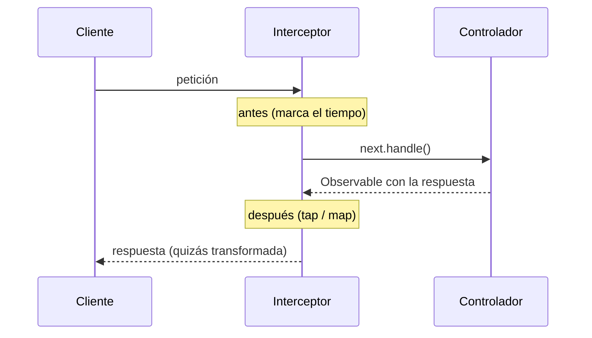

# Interceptors

<Tech ids={['nestjs']} />

<Estado tipo="construye">Un interceptor que loguea cada petición con su request id, método, ruta, código y duración, y otro que corta las peticiones que tardan demasiado.</Estado>

## Concepto

Un **interceptor** envuelve la ejecución del controlador: corre código
**antes** y **después**, y puede **transformar la respuesta** o el error. Es
el patrón *aspect-oriented programming* (AOP): sacar del controlador cosas
transversales como logs, tiempos, caché o formato de respuesta.

```ts
export interface NestInterceptor<T = any, R = any> {
  intercept(context: ExecutionContext, next: CallHandler<T>): Observable<R>;
}
```

- `context`: el mismo `ExecutionContext` de los guards.
- `next.handle()`: ejecuta el resto de la cadena (pipes y controlador) y
  devuelve un **Observable** con la respuesta.
- Lo que hagas **antes** de `next.handle()` corre antes del controlador; lo
  que encadenes con operadores de RxJS (`map`, `tap`, `catchError`,
  `timeout`) corre **después**.



### Para qué se usan

| Uso | Operador |
| --- | --- |
| Loguear y medir tiempos | `tap` |
| Transformar la respuesta (envolver en `data`, quitar campos) | `map` |
| Convertir errores | `catchError` |
| Cortar peticiones lentas | `timeout` |
| Devolver una respuesta cacheada sin llamar al controlador | devolver `of(valor)` sin llamar a `next.handle()` |

<Angular>

Es tu `HttpInterceptor` de Angular, pero del lado del servidor y con el
contexto del handler. Misma idea: recibís la petición, llamás a `next.handle()`
y trabajás sobre el Observable con operadores de RxJS. Acá vas a usar
exactamente el RxJS que ya sabés.

</Angular>

## En ripopola

### 1. Logger de peticiones

```bash
pnpm exec nx g @nx/nest:interceptor apps/api/src/app/common/logging --dry-run
```

```ts title="apps/api/src/app/common/logging.interceptor.ts"
import { CallHandler, ExecutionContext, Injectable, Logger, NestInterceptor } from '@nestjs/common';
import type { Request, Response } from 'express';
import { Observable, tap } from 'rxjs';
import { REQUEST_ID_HEADER } from './request-id.middleware';

@Injectable()
export class LoggingInterceptor implements NestInterceptor {
  private readonly logger = new Logger('HTTP');

  intercept(context: ExecutionContext, next: CallHandler): Observable<unknown> {
    const http = context.switchToHttp();
    const req = http.getRequest<Request>();
    const res = http.getResponse<Response>();
    const start = performance.now();
    const id = req.headers[REQUEST_ID_HEADER];

    return next.handle().pipe(
      tap({
        next: () => this.log(id, req, res.statusCode, start),
        error: (err) => this.log(id, req, err?.status ?? 500, start),
      }),
    );
  }

  private log(id: unknown, req: Request, status: number, start: number) {
    const ms = (performance.now() - start).toFixed(1);
    this.logger.log(`${id} ${req.method} ${req.originalUrl} ${status} ${ms}ms`);
  }
}
```

Registralo global en `AppModule`:

```ts
import { APP_INTERCEPTOR } from '@nestjs/core';

providers: [
  { provide: APP_INTERCEPTOR, useClass: LoggingInterceptor },
],
```

Salida:

```text
[HTTP] 9b1d0c… GET /api/towns?country=ES 200 12.4ms
[HTTP] 4f2e77… POST /api/towns 409 8.1ms
```

:::info Logs estructurados
En la sección 9 cambiamos este texto por **logs en JSON** (con Pino), que es
lo que entiende Google Cloud Logging para filtrar por request id, ruta o código.
:::

### 2. Timeout

Una consulta colgada no tiene que dejar al cliente esperando para siempre:

```ts title="apps/api/src/app/common/timeout.interceptor.ts"
import { CallHandler, ExecutionContext, Injectable, NestInterceptor, RequestTimeoutException } from '@nestjs/common';
import { Observable, TimeoutError, catchError, throwError, timeout } from 'rxjs';

@Injectable()
export class TimeoutInterceptor implements NestInterceptor {
  intercept(_context: ExecutionContext, next: CallHandler): Observable<unknown> {
    return next.handle().pipe(
      timeout(10_000),
      catchError((err) =>
        throwError(() => (err instanceof TimeoutError ? new RequestTimeoutException() : err)),
      ),
    );
  }
}
```

:::warning El timeout no cancela la consulta
El interceptor deja de esperar y responde 408, pero la consulta a la base
sigue corriendo. Para cortarla de verdad hace falta un `statement_timeout` en
PostgreSQL (lo vemos en la sección 11).
:::

### 3. ¿Envolver todas las respuestas en `{ data }`?

Muchos tutoriales hacen un interceptor que transforma todo en
`{ data: ..., timestamp: ... }`. **En ripopola no lo hacemos**: los códigos
HTTP ya dicen si salió bien, y OpenAPI documenta mejor las respuestas planas.
Donde sí hace falta una forma común es en las **listas paginadas**
(`items`, `total`, `page`), y eso lo arma el servicio con un DTO, no un interceptor.

Igual, para que veas el patrón, así se hace:

```ts
return next.handle().pipe(map((data) => ({ data })));
```

### 4. Serializar: no mandar campos internos

Nest trae `ClassSerializerInterceptor`, que usa `class-transformer` para
aplicar `@Exclude()` y `@Expose()` en las clases que devolvés. Con Prisma los
resultados son objetos planos, no clases, así que en ripopola elegimos qué
campos salen con **`select`** en la consulta (sección 2). Es más eficiente:
ni siquiera se leen de la base.

## Errores comunes

- **Olvidarse de devolver `next.handle()`**: el controlador nunca se ejecuta.
- **Usar `@Res()`** en el controlador: los interceptors no ven la respuesta.
- **Lógica de negocio en un interceptor**: solo cosas transversales.

<Resumen>

- Un interceptor corre antes y después del controlador, sobre un Observable.
- `tap` para efectos (logs), `map` para transformar, `catchError` para errores, `timeout` para cortar.
- Es el `HttpInterceptor` de Angular del lado del servidor.

</Resumen>

## Preguntas de entrevista

**1. ¿Qué es un interceptor y qué puede hacer que un guard no?**
Envuelve la ejecución del handler: puede actuar después de la respuesta,
transformarla, convertir errores o devolver otra cosa sin llamar al
controlador. El guard solo decide si se entra.

**2. ¿Por qué los interceptors usan RxJS?**
Porque `next.handle()` devuelve un Observable, lo que permite componer
operadores sobre la respuesta (o el stream, si el handler emite varios valores).

**3. Dá tres usos típicos.**
Logging y métricas de tiempo, caché, timeouts, transformación o
serialización de respuestas, mapeo de errores.

**4. ¿Qué es AOP?**
Programación orientada a aspectos: separar preocupaciones transversales
(logs, seguridad, caché) del código de negocio y aplicarlas de forma declarativa.

<Ejercicio title="Cabecera con la versión de la API">

Hacé un interceptor global que agregue la cabecera `x-api-version: 1` a todas las respuestas.

<details>
<summary>Solución</summary>

```ts
intercept(context: ExecutionContext, next: CallHandler) {
  context.switchToHttp().getResponse<Response>().setHeader('x-api-version', '1');
  return next.handle();
}
```

</details>
</Ejercicio>

## Glosario

| Término | Qué es |
| --- | --- |
| Interceptor | Clase que envuelve la ejecución del handler. |
| `CallHandler` | Objeto cuyo `handle()` ejecuta el resto de la cadena. |
| AOP | Programación orientada a aspectos. |
| Serialización | Convertir el resultado en la respuesta que ve el cliente. |
