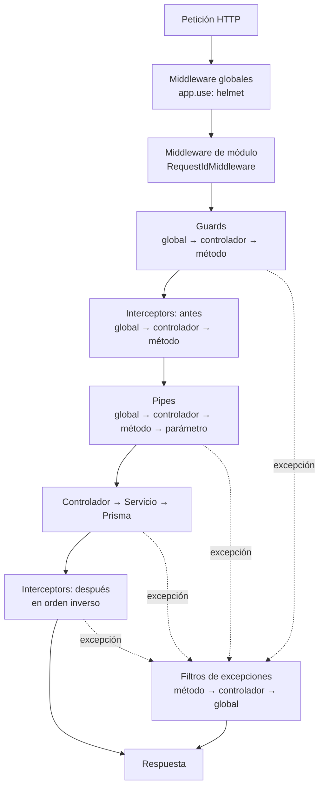

# El ciclo completo de una petición

<Tech ids={['nestjs']} />

<Estado tipo="concepto">Este tema junta todo lo anterior. No agrega código, pero es una de las preguntas más comunes en entrevistas de Nest.</Estado>

## El orden

Reglas para recordar:

1. **Middleware → Guards → Interceptors → Pipes → Handler**. Una forma de
   acordarse: primero lo que no sabe nada del handler (middleware), después
   quién puede entrar (guards), después lo que envuelve (interceptors) y por
   último lo que prepara los argumentos (pipes).
2. Dentro de cada tipo: **de lo general a lo particular** (global, controlador, método).
3. Los interceptors a la vuelta corren **al revés** (como capas de cebolla).
4. Los filtros se buscan **de lo particular a lo general**: el primero que
   coincide con el error lo maneja, y ninguno más.
5. Un error en cualquier punto salta directo a los filtros.

## Recorrido real en ripopola

`PATCH /api/towns/3f1c…` con un body inválido y sin permiso:

| Paso | Pieza de ripopola | Qué pasa |
| --- | --- | --- |
| 1 | `helmet()` | Agrega cabeceras de seguridad a la respuesta. |
| 2 | `RequestIdMiddleware` | Asigna `x-request-id`. |
| 3 | `AuthGuard` (sección 6) | Lee la sesión de Better Auth (cookie). Si no hay: **401** y se termina. |
| 4 | `RolesGuard` (sección 6) | ¿Es superadmin o del municipio? Si no: **403**. |
| 5 | `LoggingInterceptor` (antes) | Marca la hora de inicio. |
| 6 | `ParseUUIDPipe` | Si el id no es UUID: **400**. |
| 7 | `ValidationPipe` | Valida el `UpdateTownDto`. Si `population` es negativa: **400**. |
| 8 | `TownsController.update` → `TownsService.update` | Actualiza con Prisma. |
| 9 | `PrismaExceptionFilter` | Si el id no existe (P2025): **404**. |
| 10 | `LoggingInterceptor` (después) | Loguea código y duración. |

Fijate que si el usuario no tiene permiso (paso 4), **nunca se valida el
body** (paso 7). Primero se decide si podés entrar; después se mira qué mandaste.

## ¿Dónde pongo esto?

| Quiero… | Pieza |
| --- | --- |
| Agregar cabeceras, CORS, request id | Middleware |
| Saber si el usuario está logueado / tiene el rol | Guard |
| Validar o convertir un parámetro | Pipe |
| Medir tiempos, loguear, cachear, cambiar la respuesta | Interceptor |
| Convertir un error en una respuesta HTTP | Filtro de excepciones |
| Reglas de negocio | Servicio |

<Angular>

En Angular el recorrido de una navegación es: guards del router → resolvers →
componente. Y una petición HTTP pasa por la cadena de `HttpInterceptor`. Nest
junta las dos ideas en un solo ciclo del lado del servidor.

</Angular>

<Resumen>

- Orden: middleware, guards, interceptors (antes), pipes, handler, interceptors (después).
- Dentro de cada tipo: global, controlador, método.
- Los errores van a los filtros, del más específico al global.

</Resumen>

## Preguntas de entrevista

**1. ¿En qué orden se ejecutan middleware, guards, interceptors, pipes y filtros?**
Middleware, guards, interceptors (antes), pipes, handler, interceptors
(después). Los filtros entran cuando hay una excepción.

**2. Si un guard rechaza la petición, ¿se ejecutan los pipes?**
No. Los pipes van después de los guards, así que un 401/403 sale antes de validar el body.

**3. ¿En qué orden se aplican un interceptor global y uno de método?**
A la ida, primero el global y después el de método. A la vuelta, al revés.

**4. ¿Qué filtro maneja una excepción si hay uno de método y uno global?**
El más específico (el del método), si coincide con el tipo de error.
