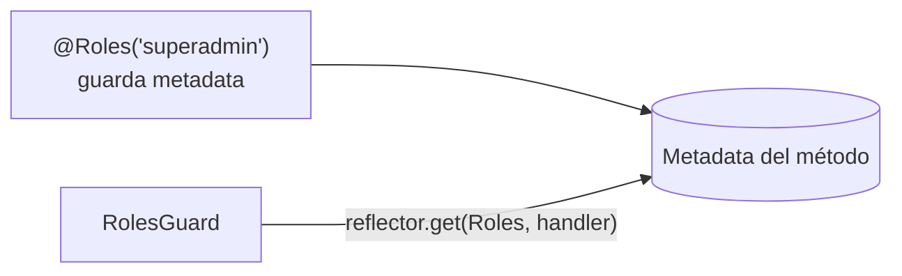

# Decoradores propios y metadata

<Tech ids={['nestjs', 'typescript']} />

<Estado tipo="construye">Los decoradores `@Public()`, `@CurrentUser()` y `@Roles()` que va a usar toda la API. Se terminan de conectar en la sección 6.</Estado>

## Concepto

### Qué es un decorador

Un decorador es **una función que se ejecuta al definir una clase** (no al
usarla) y que puede guardar información sobre la clase, un método, una
propiedad o un parámetro. Nest se apoya en ellos para todo: `@Controller`,
`@Get`, `@Body`, `@Injectable`.

```ts
function Log(target: object, key: string, descriptor: PropertyDescriptor) {
  console.log(`definiendo ${key}`); // se imprime al cargar la clase, una vez
}
```

Nest usa los **decoradores experimentales** de TypeScript
(`experimentalDecorators` y `emitDecoratorMetadata` en `tsconfig`), no los
decoradores estándar de ECMAScript, porque necesita los metadatos de tipos y
los decoradores de parámetro.

### Metadata

La mayoría de los decoradores de Nest no hacen nada por sí mismos: **guardan
metadatos** en la clase o el método con `reflect-metadata`. Después, otra
pieza (el router, un guard) los lee. Por ejemplo, `@Get(':slug')` guarda "este
método responde GET en `:slug`" y el router lo lee al arrancar.

Con eso podés crear tus propios metadatos y leerlos en un guard:



### Los tres tipos que vas a escribir

| Tipo | Para qué | Herramienta de Nest |
| --- | --- | --- |
| De metadata | Marcar un método o clase (`@Public()`, `@Roles()`) | `Reflector.createDecorator` o `SetMetadata` |
| De parámetro | Inyectar algo en el método (`@CurrentUser()`) | `createParamDecorator` |
| Compuesto | Juntar varios en uno (`@Auth('superadmin')`) | `applyDecorators` |

<Angular>

Ya usás decoradores todo el tiempo (`@Component`, `@Input`, `@HostListener`).
La diferencia: en Angular rara vez creás los tuyos, porque el compilador de
Angular los procesa. En Nest es muy común, y es la forma de hacer código
declarativo y limpio.

</Angular>

## En ripopola

### 1. `@Public()`: marcar endpoints sin login

```ts title="apps/api/src/app/auth/public.decorator.ts"
import { Reflector } from '@nestjs/core';

// Decorador tipado que guarda `true` en la metadata del método o la clase
export const Public = Reflector.createDecorator<boolean>({ transform: () => true });
```

`Reflector.createDecorator` (Nest 10+) crea a la vez el decorador y la clave
para leerlo, con tipos. La forma vieja, que vas a ver en mucho código:

```ts
export const IS_PUBLIC_KEY = 'isPublic';
export const Public = () => SetMetadata(IS_PUBLIC_KEY, true);
```

Leerlo en un guard:

```ts
constructor(private readonly reflector: Reflector) {}

canActivate(context: ExecutionContext) {
  const isPublic = this.reflector.getAllAndOverride(Public, [
    context.getHandler(), // primero el método
    context.getClass(),   // después el controlador
  ]);
  if (isPublic) return true;
  // ...verificar el token (sección 6)
}
```

`getAllAndOverride` devuelve el primer valor que encuentre: si el método lo
define, gana sobre el controlador.

### 2. `@Roles()`: qué rol pide cada endpoint

```ts title="apps/api/src/app/auth/roles.decorator.ts"
import { Reflector } from '@nestjs/core';

export type Role = 'superadmin' | 'municipality_admin' | 'municipality_editor';

export const Roles = Reflector.createDecorator<Role[]>();
```

```ts
@Roles(['superadmin'])
@Post()
create(@Body() dto: CreateTownDto) { ... }
```

### 3. `@CurrentUser()`: el usuario en el parámetro

El guard de autenticación (sección 6) deja el usuario en `request.user`. En
vez de pedir `@Req()` y sacarlo a mano:

```ts title="apps/api/src/app/auth/current-user.decorator.ts"
import { createParamDecorator, ExecutionContext } from '@nestjs/common';
import type { AuthUser } from './auth-user';

export const CurrentUser = createParamDecorator(
  (field: keyof AuthUser | undefined, context: ExecutionContext) => {
    const user = context.switchToHttp().getRequest().user as AuthUser;
    return field ? user?.[field] : user;
  },
);
```

```ts
@Patch(':id')
update(@CurrentUser() user: AuthUser, @Param('id', ParseUUIDPipe) id: string, ...) { ... }

@Get('me')
me(@CurrentUser('id') userId: string) { ... }
```

Ventajas: el controlador no depende de Express, y en los tests se pasa el usuario directo.

### 4. `@Auth()`: componer decoradores

Cuando siempre van juntos, se agrupan:

```ts title="apps/api/src/app/auth/auth.decorator.ts"
import { applyDecorators } from '@nestjs/common';
import { ApiBearerAuth, ApiForbiddenResponse } from '@nestjs/swagger';
import { Role, Roles } from './roles.decorator';

export function Auth(...roles: Role[]) {
  return applyDecorators(
    Roles(roles),
    ApiBearerAuth(),                                   // documentación OpenAPI (sección 8)
    ApiForbiddenResponse({ description: 'Sin permiso' }),
  );
}
```

```ts
@Auth('superadmin')
@Delete(':id')
remove(...) { ... }
```

## Errores comunes

- **El guard lee `undefined`**: buscás la metadata en la clase pero la pusiste en el método (o al revés). Usá `getAllAndOverride` con los dos.
- **`createParamDecorator` con pipes**: funcionan, pero solo con `validateCustomDecorators: true` en `ValidationPipe`.
- **Decoradores con lógica pesada**: corren una vez al cargar la clase; la lógica por petición va en guards o interceptors.

<Resumen>

- Los decoradores de Nest guardan metadata; otras piezas la leen.
- `Reflector.createDecorator` para marcar; `createParamDecorator` para parámetros; `applyDecorators` para componer.
- `getAllAndOverride` lee del método y del controlador, con prioridad al método.

</Resumen>

## Preguntas de entrevista

**1. ¿Qué es un decorador y cuándo se ejecuta?**
Una función que se aplica a una clase o sus miembros al definirlos (al
cargar el módulo), no en cada llamada. En Nest se usan para declarar metadata.

**2. ¿Cómo leerías un rol requerido desde un guard?**
Con `Reflector`: `getAllAndOverride(Roles, [context.getHandler(), context.getClass()])`.

**3. ¿Para qué sirve `createParamDecorator`?**
Para crear decoradores de parámetro que extraen algo del contexto, como el
usuario autenticado, sin acoplar el controlador al request de Express.

**4. ¿Qué hace `applyDecorators`?**
Junta varios decoradores en uno, para no repetirlos y para que la intención quede clara.

**5. ¿Qué diferencia hay entre `getAllAndOverride` y `getAllAndMerge`?**
El primero devuelve el primer valor encontrado (el método pisa al
controlador). El segundo junta los valores de los dos (por ejemplo, roles del controlador más roles del método).
