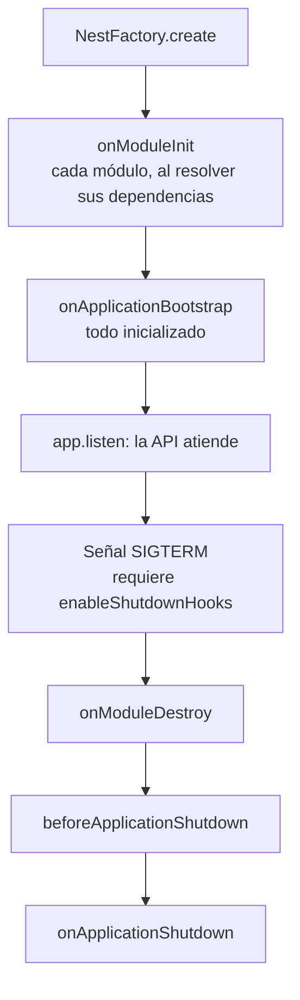

# Ciclo de vida, scopes y módulos dinámicos

<Tech ids={['nestjs']} />

<Estado tipo="construye">El `AiModule` de ripopola pasa a ser un módulo dinámico configurable (`AiModule.forRoot(...)`), como los de las librerías profesionales.</Estado>

## Ciclo de vida de la aplicación

Nest llama a ciertos métodos de tus providers, controladores y módulos en momentos fijos:



| Hook | Uso típico en ripopola |
| --- | --- |
| `onModuleInit` | `PrismaService` conecta a la base (ya lo tenés). |
| `onApplicationBootstrap` | Arrancar un consumidor de cola cuando todo está listo. |
| `onModuleDestroy` | `PrismaService` desconecta. |
| `beforeApplicationShutdown` | Dejar de aceptar trabajos y esperar los que están en curso. |
| `onApplicationShutdown` | Cerrar conexiones a Redis o a otros servicios. |

Si un hook devuelve una Promise, Nest espera a que termine. Cloud Run manda
`SIGTERM` y da unos segundos antes de matar el proceso: ahí es donde estos
hooks evitan cortar una traducción a la mitad.

<Angular>

Igual que `ngOnInit` y `ngOnDestroy`, pero de la aplicación entera y no de
un componente. En Angular el equivalente más cercano es
`provideAppInitializer` (antes `APP_INITIALIZER`) para el arranque y
`DestroyRef` para la limpieza.

</Angular>

## Scopes en profundidad

Viste los tres scopes en el tema de providers. Lo que importa para entrevistas:

- **`Scope.REQUEST` se contagia hacia arriba**: si `TownsService` inyecta algo
  request-scoped, `TownsService` también pasa a crearse por petición, y el
  controlador que lo usa también. Afecta el rendimiento.
- Un provider request-scoped puede inyectar `REQUEST` para leer la petición:

```ts
@Injectable({ scope: Scope.REQUEST })
export class LocaleService {
  constructor(@Inject(REQUEST) private readonly request: Request) {}
  get locale() {
    return this.request.headers['accept-language']?.slice(0, 2) ?? 'es';
  }
}
```

- La alternativa sin ese costo es **`AsyncLocalStorage`** de Node (o la
  librería `nestjs-cls`): guarda datos por petición sin cambiar el scope. Es
  lo que se usa para el request id en los logs o el municipio actual
  (multi-tenancy, sección 15).

## Módulos dinámicos propios

Un **módulo dinámico** devuelve su configuración desde un método estático.
Así funcionan `ConfigModule.forRoot()` o `BullModule.forRoot()`. Para
escribirlo sin repetir código, Nest trae `ConfigurableModuleBuilder`.

### En ripopola: `AiModule.forRoot()`

Queremos que el módulo de IA se configure al importarlo:

```ts
AiModule.forRoot({ provider: 'fake', dailyBudgetEur: 2 })
```

#### 1. Las opciones y el builder

```ts title="apps/api/src/app/ai/ai.module-definition.ts"
import { ConfigurableModuleBuilder } from '@nestjs/common';

export interface AiModuleOptions {
  provider: 'fake' | 'openai' | 'anthropic' | 'google';
  apiKey?: string;
  dailyBudgetEur: number;
}

export const { ConfigurableModuleClass, MODULE_OPTIONS_TOKEN: AI_OPTIONS } =
  new ConfigurableModuleBuilder<AiModuleOptions>()
    .setClassMethodName('forRoot') // genera forRoot() y forRootAsync()
    .build();
```

#### 2. El módulo

```ts title="apps/api/src/app/ai/ai.module.ts"
import { Module } from '@nestjs/common';
import { AI_OPTIONS, AiModuleOptions, ConfigurableModuleClass } from './ai.module-definition';
import { FakeTranslationProvider } from './fake-translation.provider';
import { TRANSLATION_PROVIDER } from './translation.provider';

@Module({
  providers: [
    {
      provide: TRANSLATION_PROVIDER,
      inject: [AI_OPTIONS],
      useFactory: (options: AiModuleOptions) => {
        switch (options.provider) {
          case 'fake':
            return new FakeTranslationProvider();
          default:
            throw new Error(`Proveedor de IA no implementado: ${options.provider}`);
        }
      },
    },
  ],
  exports: [TRANSLATION_PROVIDER],
})
export class AiModule extends ConfigurableModuleClass {}
```

#### 3. Importarlo con configuración asíncrona

Las opciones vienen del `.env`, así que usamos `forRootAsync` con `ConfigService` (sección 5):

```ts
AiModule.forRootAsync({
  inject: [ConfigService],
  useFactory: (config: ConfigService) => ({
    provider: config.getOrThrow('AI_PROVIDER'),
    apiKey: config.get('AI_API_KEY'),
    dailyBudgetEur: Number(config.get('AI_DAILY_BUDGET_EUR') ?? 2),
  }),
}),
```

Este patrón (`forRoot` + `forRootAsync` con `useFactory` e `inject`) es el
que vas a ver en casi todas las librerías de Nest.

## Referencias circulares y `ModuleRef`

- **`forwardRef()`** rompe dependencias circulares entre módulos o providers.
  Funciona, pero casi siempre indica que falta un tercer módulo o un evento (sección 10).
- **`ModuleRef`** permite pedir providers en tiempo de ejecución
  (`moduleRef.get(X)`, `moduleRef.resolve(X)` para request-scoped). Útil en
  casos dinámicos (por ejemplo, elegir una estrategia por nombre), pero
  esconde dependencias: usalo poco.

<Resumen>

- Hooks: `onModuleInit`, `onApplicationBootstrap`, `onModuleDestroy`, `beforeApplicationShutdown`, `onApplicationShutdown`.
- Sin `enableShutdownHooks()` no corren los de apagado.
- `Scope.REQUEST` se contagia: preferí `AsyncLocalStorage` para datos por petición.
- `ConfigurableModuleBuilder` genera `forRoot` y `forRootAsync`.

</Resumen>

## Preguntas de entrevista

**1. Nombrá los hooks de ciclo de vida de Nest y cuándo corren.**
`onModuleInit` (al resolver el módulo), `onApplicationBootstrap` (todo
listo), y al apagar `onModuleDestroy`, `beforeApplicationShutdown` y
`onApplicationShutdown`. Los de apagado requieren `enableShutdownHooks()`.

**2. ¿Qué problema tiene `Scope.REQUEST`?**
Se propaga a todo lo que lo inyecta, crea instancias por petición y baja el
rendimiento. Para datos por petición conviene `AsyncLocalStorage`.

**3. ¿Qué es un módulo dinámico y cómo lo armarías?**
Un módulo que recibe configuración al importarse y devuelve un
`DynamicModule`. Con `ConfigurableModuleBuilder` se generan `forRoot` y
`forRootAsync` con un token de opciones inyectable.

**4. ¿Para qué sirve `forRootAsync`?**
Para configurar el módulo con valores que dependen de otros providers (como
`ConfigService`) usando `useFactory` e `inject`.

**5. ¿Cómo resolvés una dependencia circular?**
Primero rediseñando: extraer lo común a otro módulo o desacoplar con eventos.
Si no hay otra, `forwardRef()` en los dos lados.
