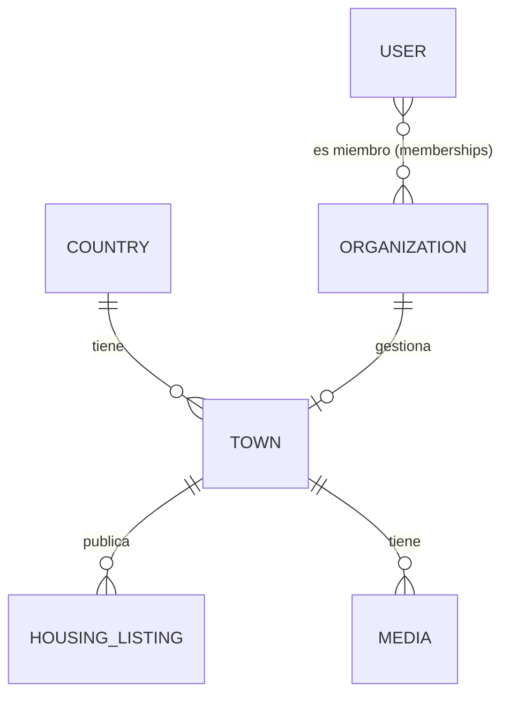

# Bases relacionales y el SQL que tenés que saber

<Tech ids={['postgresql']} />

<Estado tipo="concepto">Base teórica para todo lo que sigue. Los ejemplos de SQL los podés correr en la base local de ripopola.</Estado>

Un ORM te ahorra escribir SQL, pero **no te ahorra entenderlo**. En una
entrevista de backend te van a preguntar por índices, joins y transacciones,
y cuando una consulta de Prisma sea lenta vas a tener que leer el SQL que genera.

## Conceptos

### Tablas, filas y columnas

Una **tabla** guarda un tipo de cosa (pueblos). Cada **fila** es una cosa
(Albarracín) y cada **columna** un dato con un tipo fijo (`population integer`).

### Claves

- **Clave primaria (PK)**: identifica una fila de forma única y nunca cambia. En ripopola, `id uuid`.
- **Clave única**: otra columna que no se puede repetir (`slug`). Puede cambiar, por eso no es la PK.
- **Clave foránea (FK)**: una columna que apunta a la PK de otra tabla (`housing_listings.town_id → towns.id`). La base garantiza que el pueblo exista: eso es **integridad referencial**.

:::tip ¿Por qué UUID y no un número autoincremental?
Un UUID se puede generar en cualquier lado (también en el cliente), no
revela cuántos pueblos hay ni permite adivinar ids (`/towns/1`, `/towns/2`…).
A cambio ocupa más (16 bytes) y los UUID v4 aleatorios indexan peor. **UUID v7**
(ordenado por tiempo) resuelve eso y Prisma lo soporta con `uuid(7)`.
:::

### Relaciones



- **Uno a muchos (1:N)**: un pueblo tiene muchas viviendas. La FK va del lado "muchos".
- **Muchos a muchos (N:M)**: un usuario puede ser miembro de varias organizaciones y una organización tiene varios usuarios. Se resuelve con una **tabla intermedia** (`memberships`), que además guarda el rol.
- **Uno a uno (1:1)**: una organización municipal gestiona un pueblo.

### Normalización

Normalizar es **no repetir datos**: el nombre del país va en una tabla de
países, no copiado en cada pueblo. Si se repite, tarde o temprano queda
inconsistente. A veces se **desnormaliza a propósito** para leer más rápido
(por ejemplo, guardar el número de viviendas activas en el pueblo), pero
sabiendo que hay que mantenerlo sincronizado.

### Transacciones y ACID

Una **transacción** agrupa varias operaciones que se aplican todas o ninguna. ACID:

| Letra | Significa | Ejemplo en ripopola |
| --- | --- | --- |
| **A**tomicidad | Todo o nada. | Crear la organización y la membresía del admin juntas. |
| **C**onsistencia | Las reglas (FK, únicos, checks) siempre se cumplen. | No puede haber una vivienda de un pueblo inexistente. |
| a**I**slamiento | Las transacciones concurrentes no se pisan. | Dos editores guardando el mismo pueblo. |
| **D**urabilidad | Lo confirmado no se pierde. | Si se corta la luz después del `COMMIT`, el dato está. |

### SQL contra NoSQL

| | PostgreSQL (relacional) | MongoDB (documentos) |
| --- | --- | --- |
| Esquema | Fijo, con migraciones | Flexible por documento |
| Relaciones | Joins y FK con integridad | Embebidas o referencias sin integridad |
| Transacciones | Siempre, ACID completo | Existen, con más limitaciones |
| Ideal para | Datos relacionados, reglas fuertes, reportes | Datos con forma muy variable, alta escritura |

Ripopola es muy relacional (pueblos, viviendas, municipios, usuarios,
permisos) y necesita consultas geográficas: **PostgreSQL + PostGIS** es la elección natural.

## El SQL básico, con ripopola

Conectate a la base local (el contenedor de Docker Compose):

```bash
docker compose exec db psql -U ripopola -d ripopola
```

```sql
-- Leer con filtro, orden y límite
SELECT slug, official_name, population
FROM towns
WHERE country = 'ES' AND published = true
ORDER BY population DESC
LIMIT 10;

-- Agregar: cuántos pueblos publicados por país
SELECT country, count(*) AS total
FROM towns
WHERE published
GROUP BY country
HAVING count(*) > 5;

-- Join: viviendas con el nombre de su pueblo
SELECT h.title, h.monthly_rent, t.official_name
FROM housing_listings h
JOIN towns t ON t.id = h.town_id
WHERE t.slug = 'albarracin';

-- LEFT JOIN: pueblos aunque no tengan viviendas
SELECT t.official_name, count(h.id) AS viviendas
FROM towns t
LEFT JOIN housing_listings h ON h.town_id = t.id
GROUP BY t.id;

-- Escribir
INSERT INTO towns (id, slug, official_name, country) VALUES (gen_random_uuid(), 'teruel', 'Teruel', 'ES');
UPDATE towns SET population = 35000 WHERE slug = 'teruel';
DELETE FROM towns WHERE slug = 'teruel';
```

:::info Los nombres de las tablas
En el modelo de práctica, Prisma usa los nombres de los campos tal cual
(`officialName`). Si querés `snake_case` en la base (lo habitual en
PostgreSQL), se mapea con `@map` y `@@map`, como vemos en el próximo tema.
:::

<Resumen>

- PK estable (UUID), claves únicas para lo legible (slug), FK para la integridad.
- 1:N con FK del lado "muchos"; N:M con tabla intermedia.
- Transacciones ACID para escribir varias cosas juntas.
- Ripopola es relacional y geográfica: PostgreSQL + PostGIS.

</Resumen>

## Preguntas de entrevista

**1. ¿Diferencia entre clave primaria, única y foránea?**
La primaria identifica la fila y no cambia; la única impide repetidos en otra
columna; la foránea apunta a otra tabla y garantiza integridad referencial.

**2. ¿Cómo modelás una relación muchos a muchos?**
Con una tabla intermedia con las dos FK, que puede guardar datos propios de la relación (rol, fecha).

**3. ¿Qué es ACID?**
Atomicidad, consistencia, aislamiento y durabilidad: las garantías de una transacción.

**4. ¿Diferencia entre `INNER JOIN` y `LEFT JOIN`?**
`INNER` devuelve solo filas con coincidencia en ambas tablas; `LEFT`
devuelve todas las de la izquierda, con `NULL` donde no hay coincidencia.

**5. ¿`WHERE` o `HAVING`?**
`WHERE` filtra filas antes de agrupar; `HAVING` filtra grupos después de `GROUP BY`.

**6. ¿Cuándo elegirías MongoDB en vez de PostgreSQL?**
Con datos de forma muy variable, sin relaciones fuertes y mucho volumen de
escritura. Para datos relacionados con reglas de integridad, PostgreSQL.

**7. ¿UUID o autoincremental?**
UUID si los ids se exponen o se generan fuera de la base; mejor v7 por
rendimiento de índices. Autoincremental es más chico y rápido, pero revela volumen y es adivinable.

<Ejercicio title="Tu primera consulta">

Escribí en SQL: los 5 pueblos de Italia con más población que estén publicados.

<details>
<summary>Solución</summary>

```sql
SELECT official_name, population FROM towns
WHERE country = 'IT' AND published
ORDER BY population DESC NULLS LAST
LIMIT 5;
```

`NULLS LAST` deja al final los pueblos sin población cargada.

</details>
</Ejercicio>
