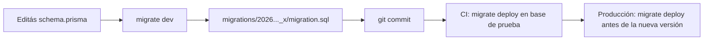

# Migraciones en el día a día

<Tech ids={['prisma', 'postgresql', 'githubactions']} />

<Estado tipo="construye">Un flujo de migraciones seguro para ripopola, incluyendo cómo renombrar una columna sin perder datos.</Estado>

## Concepto

Una migración es un **archivo SQL versionado** que lleva la base de un estado
al siguiente. Prisma guarda en la tabla `_prisma_migrations` cuáles ya se
aplicaron. (Los fundamentos están en la guía de conexión de ripopola; acá va el uso diario.)

| Comando | Dónde | Qué hace |
| --- | --- | --- |
| `prisma migrate dev --name x` | Tu máquina | Crea la migración desde el schema, la aplica y regenera el cliente. Puede proponer resetear. |
| `prisma migrate dev --create-only` | Tu máquina | Solo crea el archivo, para editarlo antes de aplicarlo. |
| `prisma migrate deploy` | CI y producción | Aplica las pendientes. Nunca genera ni resetea. |
| `prisma migrate reset` | Tu máquina | Borra la base, aplica todo de cero y corre el seed. |
| `prisma migrate status` | Cualquiera | Muestra qué está aplicado y qué falta. |
| `prisma migrate diff` | Cualquiera | Compara dos estados y muestra el SQL (útil en revisiones). |
| `prisma db push` | Prototipos | Sincroniza la base con el schema **sin migración**. No para ripopola. |



## Cambios sin perder datos: expandir y contraer

Algunos cambios son **destructivos**: borrar o renombrar una columna,
cambiar un tipo, agregar `NOT NULL` a una columna con datos. Prisma interpreta
un renombre como "borrar y crear", así que **se pierden los datos**.

La técnica estándar se llama **expand and contract** (expandir y contraer), y
además permite desplegar sin cortar el servicio:

1. **Expandir**: agregar lo nuevo sin quitar lo viejo (columna `status` opcional).
2. **Migrar los datos**: copiar de lo viejo a lo nuevo.
3. **Desplegar el código** que usa lo nuevo.
4. **Contraer**: borrar lo viejo en una migración posterior.

### En ripopola: de `published` a `status` sin perder datos

Si ya hubiera pueblos cargados, en vez de dejar que Prisma borre la columna:

```bash
pnpm exec prisma migrate dev --name town_status_expand --create-only
```

Editá el `migration.sql` generado:

```sql
-- 1. Expandir: crear el enum y la columna nueva
CREATE TYPE "town_status" AS ENUM ('DRAFT', 'PUBLISHED', 'ARCHIVED');
ALTER TABLE "towns" ADD COLUMN "status" "town_status" NOT NULL DEFAULT 'DRAFT';

-- 2. Migrar los datos
UPDATE "towns" SET "status" = 'PUBLISHED' WHERE "published" = true;
```

Aplicalo con `pnpm exec prisma migrate dev`. Cuando el código ya use
`status` en todos lados, en otra migración quitás `published` del schema
(Prisma genera el `DROP COLUMN`).

## Reglas de oro

- **Una migración aplicada en otro entorno no se edita.** Si está mal, se hace otra que lo corrija.
- **Revisá siempre el SQL** antes de commitear. Buscá `DROP`.
- **Las migraciones van al repo** junto con el cambio de código que las necesita.
- **Revertir el código no revierte la base**. Por eso los cambios tienen que ser compatibles con la versión anterior del código (expand and contract).
- **En producción corren antes de arrancar la nueva versión** (sección 14).

## Cuando algo sale mal

| Situación | Qué hacer |
| --- | --- |
| `migrate dev` detecta *drift* (alguien tocó la base a mano) | En local: `migrate reset`. En producción: investigar y crear una migración que lo refleje. |
| Una migración falló a la mitad en producción | `prisma migrate resolve --rolled-back <nombre>` después de arreglar, o `--applied` si se completó a mano. |
| Necesitás datos de prueba siempre | Seed (sección 3), que corre con `migrate reset`. |

<Alternativa title="Migraciones en TypeORM">

TypeORM genera migraciones **en TypeScript** comparando las entidades con la
base (`migration:generate`) y tiene `synchronize: true`, que sincroniza solo
al arrancar: cómodo, pero **peligroso en producción** porque puede borrar
columnas. El equivalente en Prisma es `db push`. Otras herramientas del
mercado independientes del ORM: Flyway, Liquibase, dbmate.

</Alternativa>

<Resumen>

- `migrate dev` en local, `migrate deploy` en CI y producción.
- `--create-only` para editar el SQL (PostGIS, datos, renombres).
- Cambios destructivos con expandir y contraer.
- Nunca editar una migración ya aplicada en otro entorno.

</Resumen>

## Preguntas de entrevista

**1. ¿Qué diferencia hay entre `migrate dev` y `migrate deploy`?**
`dev` genera y aplica migraciones, y puede resetear la base; es para
desarrollo. `deploy` solo aplica las pendientes; es para CI y producción.

**2. ¿Cómo renombrás una columna con datos sin perderlos ni cortar el servicio?**
Expand and contract: agregar la nueva, copiar los datos, desplegar el código
que la usa y borrar la vieja en una migración posterior.

**3. ¿Por qué no usar `synchronize` o `db push` en producción?**
Porque aplican cambios sin historial ni revisión, y pueden borrar columnas con datos.

**4. Si hacés rollback del código, ¿qué pasa con la base?**
Nada: la migración sigue aplicada. Por eso los cambios de esquema deben ser
compatibles con la versión anterior del código.

**5. ¿Qué es el drift?**
Diferencia entre el estado real de la base y lo que dicen las migraciones, normalmente por cambios manuales.
