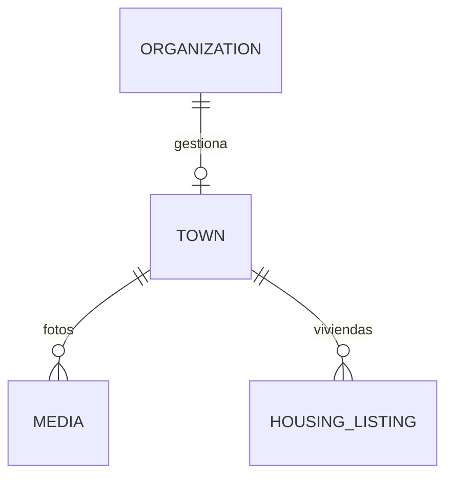

# Uno a muchos y uno a uno

<Tech ids={['prisma', 'postgresql']} />

<Estado tipo="construye">Los modelos `Media` (fotos del pueblo), `HousingListing` (viviendas) y `Organization` (el ayuntamiento que gestiona el pueblo).</Estado>

## Concepto

En Prisma una relación se declara **en los dos modelos**, pero solo uno
tiene la **columna real** (la FK). El otro lado es un campo virtual que
Prisma usa para navegar.

```prisma
model Town {
  id     String  @id
  photos Media[]              // virtual: no hay columna
}

model Media {
  id     String @id
  townId String @map("town_id") @db.Uuid               // la columna real (FK)
  town   Town   @relation(fields: [townId], references: [id]) // cómo se une
}
```

- `fields`: la columna de este modelo.
- `references`: la columna del otro modelo (casi siempre su `id`).
- El lado que tiene `fields` es el que lleva la FK: siempre el lado "muchos" en 1:N.

## En ripopola



### 1. Fotos del pueblo (1:N)

```prisma title="schema.prisma"
model Media {
  id        String   @id @default(uuid(7)) @db.Uuid
  townId    String   @map("town_id") @db.Uuid
  town      Town     @relation(fields: [townId], references: [id], onDelete: Cascade)
  /// Ruta en Cloud Storage (sección 7), no una URL pública
  storageKey String  @map("storage_key")
  alt       Json?    // texto alternativo por idioma
  position  Int      @default(0)
  createdAt DateTime @default(now()) @map("created_at") @db.Timestamptz(3)

  @@index([townId, position])
  @@map("media")
}
```

### 2. Viviendas (1:N)

```prisma
enum HousingOperation {
  RENT
  SALE
  @@map("housing_operation")
}

model HousingListing {
  id          String           @id @default(uuid(7)) @db.Uuid
  townId      String           @map("town_id") @db.Uuid
  town        Town             @relation(fields: [townId], references: [id], onDelete: Restrict)
  operation   HousingOperation
  title       String           @db.VarChar(140)
  /// Céntimos para no perder precisión. null = precio a consultar (distinto de 0)
  priceCents  Int?             @map("price_cents")
  currency    String           @default("EUR") @db.Char(3)
  bedrooms    Int?
  publishedAt DateTime?        @map("published_at") @db.Timestamptz(3)
  expiresAt   DateTime?        @map("expires_at") @db.Timestamptz(3)

  @@index([townId, operation])
  @@map("housing_listings")
}
```

### 3. El ayuntamiento que gestiona el pueblo (1:1)

```prisma
model Organization {
  id     String  @id @default(uuid(7)) @db.Uuid
  name   String  @db.VarChar(160)
  town   Town?   // virtual
  @@map("organizations")
}

model Town {
  // ...campos anteriores
  organizationId String?          @unique @map("organization_id") @db.Uuid
  organization   Organization?    @relation(fields: [organizationId], references: [id])
  photos         Media[]
  housing        HousingListing[]
}
```

El `@unique` en `organizationId` es lo que convierte la relación en **1:1**:
sin él, varias filas podrían apuntar a la misma organización (1:N).
`organizationId` es opcional porque ripopola puede cargar un pueblo antes de
que su ayuntamiento se registre (el *claim* del municipio).

### 4. Migrar

```bash
pnpm exec prisma migrate dev --name media_housing_organizations
```

Mirá el SQL: aparecen `FOREIGN KEY ... REFERENCES "towns"("id") ON DELETE CASCADE`.
Prisma **no crea índices automáticos en las FK** en PostgreSQL: por eso
pusimos `@@index([townId, ...])`. Sin ellos, cada `include` y cada borrado
en cascada hace un scan completo.

### 5. `onDelete`: ¿qué pasa con los hijos?

| Opción | Al borrar el pueblo… | En ripopola |
| --- | --- | --- |
| `Cascade` | Se borran los hijos. | Fotos: no tienen sentido sin el pueblo. |
| `Restrict` | Error si hay hijos. | Viviendas: no se pueden perder por un borrado accidental. |
| `SetNull` | La FK queda en `NULL` (tiene que ser opcional). | La organización si se borra el pueblo. |
| `NoAction` | Como `Restrict`, pero se comprueba al final de la transacción. | — |

Lo vemos a fondo, junto con el borrado lógico, en el tema 5 de esta sección.

<Alternativa title="TypeORM">

En TypeORM se declara con `@ManyToOne(() => Town, (t) => t.photos)` en el
hijo y `@OneToMany(() => Media, (m) => m.town)` en el padre, más
`@JoinColumn` en el 1:1. El concepto de "dueño de la relación" (quién tiene
la FK) es el mismo.

</Alternativa>

<Resumen>

- La FK vive en el lado "muchos"; el otro lado es virtual.
- `@unique` en la FK convierte 1:N en 1:1.
- Indexá las FK: Prisma no lo hace en PostgreSQL.
- `onDelete` decide qué pasa con los hijos.

</Resumen>

## Preguntas de entrevista

**1. En una relación uno a muchos, ¿dónde va la clave foránea?**
En la tabla del lado "muchos" (cada foto apunta a su pueblo).

**2. ¿Cómo hacés una relación uno a uno?**
Con una FK con restricción única en una de las dos tablas.

**3. ¿Las claves foráneas tienen índice automático en PostgreSQL?**
No. La PK sí, pero la FK no: conviene crearlo para joins y borrados.

**4. ¿Qué diferencia hay entre `Cascade` y `Restrict`?**
`Cascade` borra los hijos con el padre; `Restrict` impide borrar el padre si tiene hijos.
