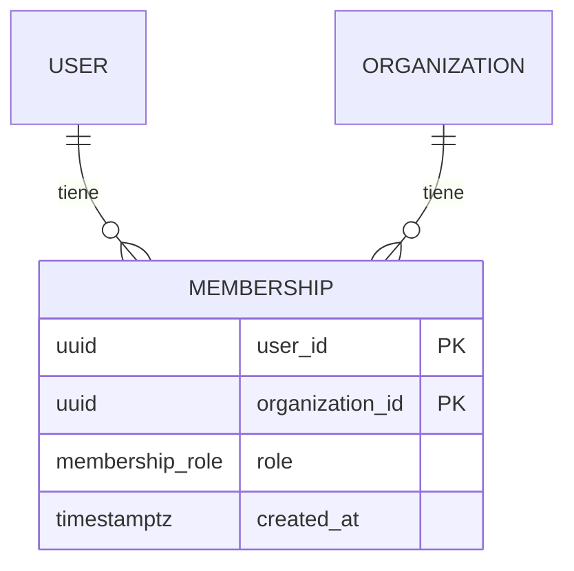

# Muchos a muchos con datos propios

<Tech ids={['prisma', 'postgresql']} />

<Estado tipo="construye">Los modelos `User` y `Membership`: quién trabaja en qué ayuntamiento y con qué rol. Es la base de los permisos de la sección 6.</Estado>

## Implícita contra explícita

Prisma ofrece dos formas:

```prisma
// Implícita: Prisma crea la tabla intermedia (_TownToTag) y no la ves
model Town { tags Tag[] }
model Tag  { towns Town[] }
```

```prisma
// Explícita: vos definís la tabla intermedia como un modelo
model Membership {
  userId         String
  organizationId String
  role           MembershipRole
  @@id([userId, organizationId])
}
```

Usá la **explícita** cuando la relación tiene **datos propios** (rol, fecha
de alta, quién invitó) o cuando querés controlar nombres e índices. En la
práctica, casi siempre.

## En ripopola: usuarios y ayuntamientos

Un ayuntamiento tiene varias personas en el panel (alcaldesa, técnico de
turismo), y una persona puede trabajar para más de un ayuntamiento (por
ejemplo, una mancomunidad o una consultora).



```prisma title="schema.prisma"
enum PlatformRole {
  USER
  SUPERADMIN
  @@map("platform_role")
}

enum MembershipRole {
  ADMIN   // gestiona miembros y publica
  EDITOR  // edita contenido, no publica
  @@map("membership_role")
}

model User {
  id           String       @id @default(uuid(7)) @db.Uuid
  email        String       @unique
  name         String
  platformRole PlatformRole @default(USER) @map("platform_role")
  memberships  Membership[]
  createdAt    DateTime     @default(now()) @map("created_at") @db.Timestamptz(3)
  // En la sección 6, Better Auth suma emailVerified, image, sesiones y cuentas

  @@map("users")
}

model Membership {
  userId         String         @map("user_id") @db.Uuid
  organizationId String         @map("organization_id") @db.Uuid
  role           MembershipRole
  createdAt      DateTime       @default(now()) @map("created_at") @db.Timestamptz(3)
  user           User           @relation(fields: [userId], references: [id], onDelete: Cascade)
  organization   Organization   @relation(fields: [organizationId], references: [id], onDelete: Cascade)

  @@id([userId, organizationId])   // un usuario, una sola membresía por organización
  @@index([organizationId])        // listar los miembros de un ayuntamiento
  @@map("memberships")
}

model Organization {
  // ...
  memberships Membership[]
}
```

Qué mirar:

- **Clave primaria compuesta** `@@id([userId, organizationId])`: no puede
  haber dos membresías del mismo usuario en la misma organización.
- El índice por `organizationId` cubre la búsqueda inversa (la PK ya cubre por `userId`).
- Dos niveles de rol: el de **plataforma** (`SUPERADMIN`, para vos) y el de
  **organización** (`ADMIN`, `EDITOR`). Mezclarlos en un solo campo es un error común.
- La identidad (contraseñas, sesiones, cuentas de Google) la agrega **Better Auth** en la sección 6, en tablas propias que apuntan a `users`. Acá solo modelamos lo del producto.

### Consultas típicas

```ts
// ¿Qué ayuntamientos gestiona este usuario y con qué rol?
prisma.membership.findMany({
  where: { userId },
  select: { role: true, organization: { select: { id: true, name: true, town: { select: { slug: true } } } } },
});

// ¿Puede este usuario editar este pueblo?
const canEdit = await prisma.membership.count({
  where: { userId, organization: { town: { id: townId } } },
}) > 0;

// Agregar un editor
prisma.membership.create({ data: { userId, organizationId, role: 'EDITOR' } });
```

Fijate en el filtro **a través de relaciones** (`organization: { town: { id } }`):
Prisma genera el join por vos.

<Alternativa title="TypeORM">

`@ManyToMany` con `@JoinTable` crea la tabla intermedia implícita. Si la
relación tiene datos (como el rol), en TypeORM también se modela como una
entidad intermedia con dos `@ManyToOne`. Mismo concepto.

</Alternativa>

<Resumen>

- N:M explícita (un modelo intermedio) cuando la relación tiene datos propios.
- PK compuesta para evitar duplicados.
- Rol de plataforma y rol de organización, separados.
- Los filtros pueden atravesar relaciones.

</Resumen>

## Preguntas de entrevista

**1. ¿Cuándo usarías una tabla intermedia explícita?**
Cuando la relación tiene atributos propios (rol, fechas) o necesito controlar sus índices y nombres.

**2. ¿Cómo evitás membresías duplicadas?**
Con una clave primaria o única compuesta sobre las dos FK.

**3. ¿Por qué separar rol de plataforma y rol por organización?**
Porque responden preguntas distintas: qué puede hacer alguien en todo el
sistema y qué puede hacer dentro de una organización concreta.
