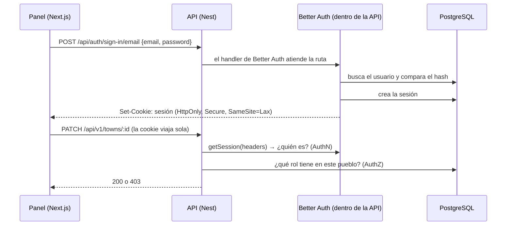
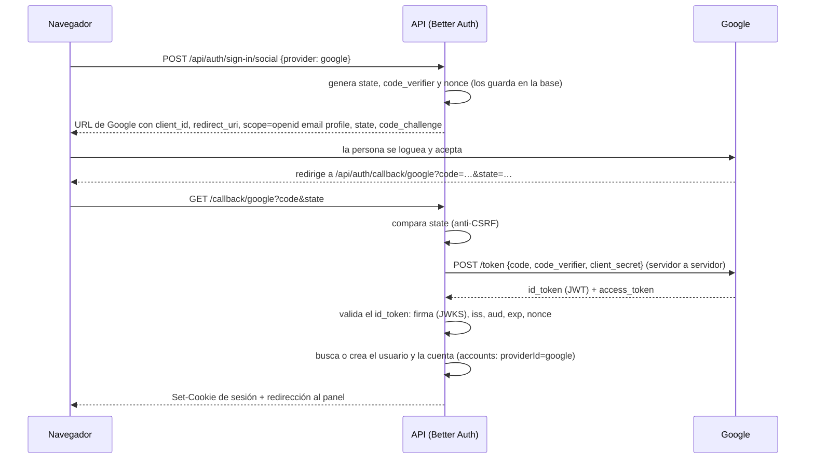

# Autenticación y autorización: conceptos

<Tech ids={['betterauth', 'nestjs', 'postgresql']} />

<Estado tipo="concepto">La teoría de cualquier sistema de login. En ripopola la vas a ver funcionando con Better Auth, que corre dentro de la API y guarda todo en PostgreSQL.</Estado>

## Dos preguntas distintas

- **Autenticación (AuthN)**: ¿quién sos? → si falla, **401 Unauthorized**.
- **Autorización (AuthZ)**: ¿podés hacer esto? → si falla, **403 Forbidden**.

Ripopola resuelve **las dos dentro de su propia API**:

- **Autenticación** con **Better Auth**, una librería de TypeScript que se
  monta en Nest: registro con correo y contraseña, login con Google,
  verificación de correo, recuperación de contraseña, sesiones y 2FA. Los
  usuarios y las sesiones quedan en **la misma base PostgreSQL**, con Prisma.
- **Autorización** con código propio: roles de plataforma, membresías por
  ayuntamiento y `TownPolicy` (tema 4).



## Contraseñas: lo que nunca se hace

Ripopola guarda contraseñas (en la tabla `accounts`, hasheadas por Better
Auth), así que esto ya no es teoría:

- **Nunca en texto plano ni cifradas** (lo cifrado se puede descifrar).
- Se guardan **hasheadas con un algoritmo lento y con sal**: **Argon2id**
  (la recomendación de OWASP), **scrypt** (el que usa Better Auth por
  defecto) o **bcrypt**. Nunca MD5 ni SHA-256 a secas: son rápidos, y
  "rápido" es lo que quiere un atacante para probar millones de contraseñas.
- La **sal** (aleatoria por usuario) hace que dos contraseñas iguales tengan
  hashes distintos y anula las tablas precalculadas.
- Política razonable: **largo mínimo** (8 a 12 caracteres) en vez de reglas
  raras de símbolos, y bloquear contraseñas filtradas conocidas.

```ts
// bcrypt, como en el curso de referencia (tema 6)
const hash = await bcrypt.hash(password, 12);   // 12 = costo
const ok = await bcrypt.compare(password, hash);
```

Una librería de autenticación (Better Auth) o un proveedor externo
(Firebase, Auth0) te dan además lo que cuesta hacer bien a mano:
verificación de correo, recuperación, login social, límites contra fuerza
bruta y MFA.

## Sesiones contra tokens

| | Sesión con estado | Token (JWT) sin estado |
| --- | --- | --- |
| Qué guarda el cliente | Un id de sesión en una cookie | El token entero |
| Qué guarda el servidor | La sesión (base o Redis) | Nada: verifica la firma |
| Cerrar sesión / revocar | Inmediato: se borra la sesión | Difícil: el token vale hasta que expira |
| Escala | Necesita almacenamiento compartido | Cualquier instancia verifica sola |
| Costo por petición | Una lectura (base, Redis o caché en cookie) | Verificar una firma |

**Ripopola usa sesiones**: Better Auth guarda cada sesión en la tabla
`sessions` y manda al navegador una cookie firmada con el token de sesión.
La ventaja que más importa para un panel de ayuntamientos: si alguien deja
la organización o pierde el teléfono, **se cierran sus sesiones al
instante**. El costo de leer la sesión en cada petición se baja con la
caché en cookie o con Redis (tema 5).

### Qué es un JWT

Tres partes en base64url separadas por puntos: `header.payload.firma`.

```json
{ "alg": "RS256", "kid": "abc" }
{ "sub": "0193f…", "email": "ana@ayto.es", "exp": 1767225600, "iss": "https://accounts.google.com", "aud": "client-id" }
```

- El payload **no está cifrado**: cualquiera lo lee. Nunca pongas datos sensibles.
- La **firma** garantiza que nadie lo modificó. Con **RS256** firma una
  clave privada y verifica cualquiera con la clave pública (publicada como
  **JWKS**). Con **HS256** se usa un secreto compartido (lo que hace el curso
  de referencia con `JWT_SECRET`).
- **Expiración corta** + un **refresh token** para pedir uno nuevo sin volver a loguearse.

En ripopola vas a ver JWT en un lugar concreto: el **ID token** que Google
devuelve en el login social, que Better Auth valida por vos.

## OAuth 2.0 y OpenID Connect

- **OAuth 2.0** es para **autorizar** a una app a acceder a recursos en tu
  nombre ("dejá que esta app lea tu Google Calendar"). Entrega un
  *access token*.
- **OpenID Connect (OIDC)** se monta sobre OAuth para **autenticar**: agrega
  el **ID token** (un JWT) que dice quién sos. "Entrar con Google" es OIDC.

### Los roles

| Rol | En "Entrar con Google" de ripopola |
| --- | --- |
| *Resource owner* | La persona que se loguea |
| *Client* | La API de ripopola (Better Auth), con `client_id` y `client_secret` |
| *Authorization server* | Google (`accounts.google.com`) |
| *Redirect URI* | `https://api.ripopola.com/api/auth/callback/google` |

### El flujo Authorization Code con PKCE, paso a paso

Es el flujo recomendado hoy para cualquier app (OAuth 2.1 lo hace
obligatorio). El *implicit flow*, que devolvía el token en la URL, está
desaconsejado.



Qué protege cada pieza (pregunta clásica de entrevista):

- **`state`**: un valor aleatorio que el cliente guarda y compara al volver.
  Evita que un atacante te haga terminar un login que él empezó (CSRF del login).
- **PKCE** (`code_verifier` secreto y `code_challenge` = su hash): si alguien
  intercepta el `code` en la redirección, no le sirve sin el verifier. Es
  imprescindible para clientes públicos (SPA, móviles) y se recomienda
  también para clientes con secreto.
- **`nonce`**: va dentro del ID token y evita reutilizar un token viejo (*replay*).
- **El `code` se cambia por tokens servidor a servidor**: los tokens de
  Google nunca pasan por la URL ni por el navegador.
- **Validar el ID token**: firma con las claves públicas de Google (JWKS),
  emisor (`iss`), audiencia (`aud` = tu `client_id`) y expiración.

<Angular>

Si alguna vez usaste `angular-oauth2-oidc` o MSAL, eran el *client* corriendo
en el navegador (cliente público, con PKCE y sin secreto). En ripopola el
client es **el backend**: el navegador solo sigue redirecciones y termina
con una cookie de sesión. Es el patrón **BFF** (*Backend for Frontend*), el
más seguro para SPAs, porque ningún token queda en el JavaScript.

</Angular>

## Dónde guarda el navegador la sesión

| Lugar | Riesgo |
| --- | --- |
| `localStorage` | **XSS**: cualquier script inyectado lo lee. |
| Cookie `HttpOnly; Secure; SameSite` | El JavaScript no la lee (protege de XSS), pero hay que cuidarse de **CSRF**. |
| Memoria | Seguro, pero se pierde al recargar. |

- **XSS**: se inyecta JavaScript en tu página. Defensa: React (como Angular)
  escapa por defecto, *Content Security Policy*, y nunca
  `dangerouslySetInnerHTML` con datos de usuarios.
- **CSRF**: otro sitio hace que el navegador mande una petición con tus
  cookies. Defensa: cookies `SameSite=Lax` (el navegador no las manda en
  peticiones `POST` desde otro sitio), **verificar el `Origin`** contra una
  lista de orígenes confiables y no cambiar estado con `GET`.

**En ripopola**: cookie de sesión `HttpOnly`, `Secure` y `SameSite=Lax`,
y Better Auth rechaza las peticiones cuyo `Origin` no esté en
`trustedOrigins`. El panel nunca toca un token.

<Resumen>

- 401 = no sé quién sos; 403 = sé quién sos y no podés.
- Contraseñas con algoritmo lento y sal (Argon2id, scrypt, bcrypt).
- Ripopola: sesiones en PostgreSQL y cookie `HttpOnly`; revocación inmediata.
- OIDC para login, OAuth para acceso delegado; Authorization Code + PKCE, `state` y `nonce`.
- Cookies: `SameSite` + verificación de `Origin` contra CSRF; `HttpOnly` contra XSS.

</Resumen>

## Preguntas de entrevista

**1. ¿Diferencia entre autenticación y autorización?**
Autenticación verifica identidad (401 si falla); autorización verifica permisos (403 si falla).

**2. ¿Cómo guardarías contraseñas?**
Con un algoritmo lento y con sal por usuario (Argon2id, scrypt o bcrypt). Nunca texto plano, cifrado reversible ni hashes rápidos.

**3. ¿Sesiones o JWT?**
Sesiones cuando importa revocar al instante y hay un almacenamiento compartido (base o Redis); JWT cuando muchos servicios tienen que verificar la identidad sin consultar a nadie. Muchos sistemas combinan sesión en el navegador y JWT cortos entre servicios.

**4. ¿Qué es un JWT y qué garantiza?**
Un token con header, payload y firma. Garantiza integridad y origen, no confidencialidad: el payload se puede leer.

**5. ¿Cómo revocás un JWT?**
No se puede directamente: se usan expiraciones cortas, refresh tokens revocables y, si hace falta, una lista de revocación.

**6. ¿Diferencia entre OAuth 2.0 y OpenID Connect?**
OAuth autoriza acceso delegado a recursos (access token); OIDC agrega identidad con un ID token para autenticar.

**7. Explicá el flujo Authorization Code con PKCE.**
El cliente redirige al proveedor con un `state` y un `code_challenge`; el proveedor devuelve un `code` a la redirect URI; el cliente verifica el `state` y cambia el `code` por tokens enviando el `code_verifier` (y su secreto, si es confidencial); valida el ID token y crea la sesión.

**8. ¿Para qué sirven `state`, PKCE y `nonce`?**
`state` evita el CSRF del login; PKCE evita que un `code` interceptado sirva; `nonce` evita reutilizar un ID token viejo.

**9. ¿Qué es CSRF y cómo lo evitás con cookies?**
Un sitio ajeno dispara peticiones con las cookies del usuario. Se evita con `SameSite`, verificando el `Origin` y con tokens anti-CSRF, y no cambiando estado con `GET`.

**10. ¿RS256 o HS256?**
RS256 (asimétrico) cuando quien verifica no debe poder firmar, por ejemplo con un proveedor externo que publica sus claves en JWKS. HS256 usa un secreto compartido entre quien firma y quien verifica.

**11. ¿Qué es el patrón BFF?**
Que el backend sea el cliente OAuth y le dé al navegador solo una cookie de sesión `HttpOnly`, para que ningún token quede expuesto en el JavaScript.
