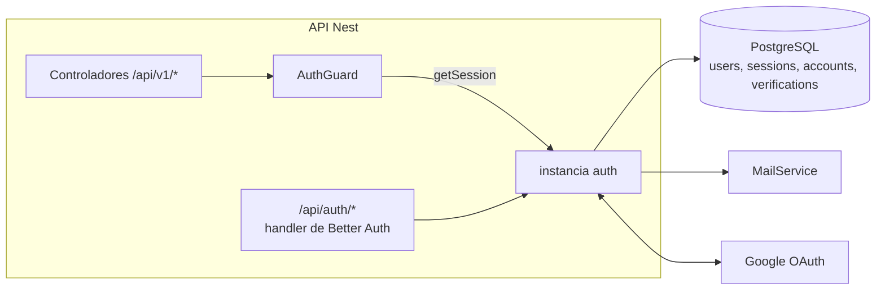

# Better Auth dentro de Nest

<Tech ids={['betterauth', 'nestjs', 'prisma', 'nextdotjs']} />

<Estado tipo="construye">La autenticación completa de ripopola corriendo dentro de la API: registro y login con correo (con verificación), login con Google, sesiones en PostgreSQL y el cliente del panel.</Estado>

## Qué es Better Auth

**Better Auth** es una librería de autenticación para TypeScript,
independiente del framework. No es un servicio externo: **corre dentro de
tu API**, usa **tu base de datos** (con un adaptador de Prisma) y expone
sus propias rutas (`/api/auth/sign-in/email`, `/api/auth/callback/google`,
etc.). Lo que no viene en el núcleo se suma con **plugins**: 2FA,
organizaciones, admin, passkeys, magic links.

Por qué encaja con ripopola:

- **Los usuarios son tuyos**: viven en PostgreSQL junto al resto de los
  datos, con claves foráneas reales hacia membresías, mensajes y anuncios.
- **Sin costo por usuario** y sin depender de un proveedor para algo tan central.
- **Sesiones revocables** al instante y cookies `HttpOnly` (tema 1).
- Es **open source** y está entre las opciones más usadas hoy en el
  ecosistema TypeScript. Nest no trae una solución propia más allá de Passport.



## En ripopola

### 1. Instalar

```bash
pnpm add -E better-auth
pnpm dlx auth secret        # genera BETTER_AUTH_SECRET
```

El CLI de Better Auth se publica como el paquete **`auth`** (`pnpm dlx
auth …`). Fijá la versión de `better-auth` con `-E`, como todo en el
proyecto (regla D-04), y usá el CLI de la misma versión.

### 2. Variables de entorno

```bash title="apps/api/.env"
BETTER_AUTH_SECRET=...                          # firma cookies y tokens; 32+ caracteres
BETTER_AUTH_URL=http://localhost:3000           # URL pública de la API
CORS_ORIGINS=http://localhost:4300,http://localhost:4000   # panel y web
GOOGLE_CLIENT_ID=...
GOOGLE_CLIENT_SECRET=...
SMTP_URL=smtp://localhost:1025                  # Mailpit en desarrollo
```

Sumalas a `EnvironmentVariables` (sección 5) para que la API **no arranque**
si falta alguna. `BETTER_AUTH_SECRET` en producción va a Secret Manager.

### 3. Las tablas: Prisma manda

Better Auth necesita cuatro modelos: `user`, `session`, `account`
(credenciales y cuentas sociales: una persona puede tener contraseña **y**
Google) y `verification` (códigos de verificación de correo, reseteo de
contraseña, `state` de OAuth). El `User` de la sección 3 cambia así:

```prisma title="apps/api/prisma/schema.prisma"
model User {
  id            String       @id @default(uuid(7)) @db.Uuid
  name          String
  email         String       @unique
  emailVerified Boolean      @default(false) @map("email_verified")
  image         String?
  platformRole  PlatformRole @default(USER) @map("platform_role")   // nuestro
  sessions      Session[]
  accounts      Account[]
  memberships   Membership[]                                       // nuestro
  createdAt     DateTime     @default(now()) @map("created_at") @db.Timestamptz(3)
  updatedAt     DateTime     @updatedAt @map("updated_at") @db.Timestamptz(3)

  @@map("users")
}

model Session {
  id        String   @id @default(uuid(7)) @db.Uuid
  token     String   @unique
  expiresAt DateTime @map("expires_at") @db.Timestamptz(3)
  ipAddress String?  @map("ip_address")
  userAgent String?  @map("user_agent")
  userId    String   @map("user_id") @db.Uuid
  user      User     @relation(fields: [userId], references: [id], onDelete: Cascade)
  createdAt DateTime @default(now()) @map("created_at") @db.Timestamptz(3)
  updatedAt DateTime @updatedAt @map("updated_at") @db.Timestamptz(3)

  @@index([userId])
  @@map("sessions")
}

model Account {
  id                    String    @id @default(uuid(7)) @db.Uuid
  accountId             String    @map("account_id")      // id en el proveedor (sub de Google)
  providerId            String    @map("provider_id")     // 'credential' | 'google'
  userId                String    @map("user_id") @db.Uuid
  user                  User      @relation(fields: [userId], references: [id], onDelete: Cascade)
  password              String?                           // hash, solo para 'credential'
  accessToken           String?   @map("access_token")
  refreshToken          String?   @map("refresh_token")
  idToken               String?   @map("id_token")
  accessTokenExpiresAt  DateTime? @map("access_token_expires_at") @db.Timestamptz(3)
  refreshTokenExpiresAt DateTime? @map("refresh_token_expires_at") @db.Timestamptz(3)
  scope                 String?
  createdAt             DateTime  @default(now()) @map("created_at") @db.Timestamptz(3)
  updatedAt             DateTime  @updatedAt @map("updated_at") @db.Timestamptz(3)

  @@index([userId])
  @@map("accounts")
}

model Verification {
  id         String   @id @default(uuid(7)) @db.Uuid
  identifier String
  value      String
  expiresAt  DateTime @map("expires_at") @db.Timestamptz(3)
  createdAt  DateTime @default(now()) @map("created_at") @db.Timestamptz(3)
  updatedAt  DateTime @updatedAt @map("updated_at") @db.Timestamptz(3)

  @@index([identifier])
  @@map("verifications")
}
```

Qué mirar:

- `displayName` pasa a ser `name` (Better Auth lo exige) y desaparece
  `firebaseUid`: el id del usuario es nuestro.
- Los **nombres de los campos** (`emailVerified`, `providerId`…) son los que
  espera Better Auth; con `@map` las columnas siguen en `snake_case`.
- **`pnpm dlx auth generate`** genera estos modelos a partir de tu
  configuración (incluidos los de cada plugin). Usalo como referencia y
  **compará con tu schema**: la salida del CLI de tu versión es la fuente de
  verdad de qué campos hacen falta.
- Después, como siempre: `pnpm prisma migrate dev --name auth` (sección 2).

### 4. Correos: un puerto y Mailpit

Better Auth no manda correos: te llama con la URL y vos lo mandás. Un
puerto, como `StorageService` (sección 7):

```ts title="mail/mail.service.ts"
export abstract class MailService {
  abstract send(msg: { to: string; subject: string; html: string }): Promise<void>;
}
```

En desarrollo, un adaptador SMTP con `nodemailer` contra **Mailpit**, que
atrapa todos los correos y los muestra en una web local:

```yaml title="compose.yaml (agregar el servicio)"
  mailpit:
    image: axllent/mailpit:latest   # fijá la versión estable al instalar (D-04)
    ports: ['1025:1025', '8025:8025'] # SMTP y web en http://localhost:8025
```

El proveedor de correo de producción (Resend, Brevo, Amazon SES…) es una
decisión pendiente: con el puerto, cambiarlo es un adaptador nuevo.

### 5. La configuración de Better Auth

Una **función** que recibe sus dependencias y devuelve la instancia. Así
la usan Nest (con inyección) y el CLI (con una instancia propia):

```ts title="apps/api/src/app/auth/auth.config.ts"
import { betterAuth } from 'better-auth';
import { prismaAdapter } from 'better-auth/adapters/prisma';
import type { PrismaClient } from '../../generated/prisma/client';
import type { MailService } from '../mail/mail.service';

export interface AuthDeps {
  prisma: PrismaClient;
  mail: MailService;
  env: {
    BETTER_AUTH_URL: string; BETTER_AUTH_SECRET: string; CORS_ORIGINS: string[];
    GOOGLE_CLIENT_ID: string; GOOGLE_CLIENT_SECRET: string; COOKIE_DOMAIN?: string;
  };
}

export function createAuth({ prisma, mail, env }: AuthDeps) {
  return betterAuth({
    appName: 'ripopola',
    baseURL: env.BETTER_AUTH_URL,
    basePath: '/api/auth',
    secret: env.BETTER_AUTH_SECRET,
    trustedOrigins: env.CORS_ORIGINS,          // también es la defensa CSRF (tema 1)
    database: prismaAdapter(prisma, { provider: 'postgresql' }),

    advanced: {
      database: { generateId: false },         // los ids los pone Prisma: uuid(7)
      // En producción: cookie para *.ripopola.com (panel, web y api comparten sitio)
      crossSubDomainCookies: env.COOKIE_DOMAIN ? { enabled: true, domain: env.COOKIE_DOMAIN } : undefined,
    },

    user: {
      additionalFields: {
        // input: false → nadie puede mandarlo al registrarse
        platformRole: { type: 'string', defaultValue: 'USER', input: false },
      },
    },

    emailAndPassword: {
      enabled: true,
      requireEmailVerification: true,          // sin correo verificado, no hay sesión
      minPasswordLength: 10,
      revokeSessionsOnPasswordReset: true,
      sendResetPassword: async ({ user, url }) => {
        void mail.send({ to: user.email, subject: 'Cambiá tu contraseña de ripopola', html: `<a href="${url}">Elegir una nueva</a>` });
      },
    },

    emailVerification: {
      sendOnSignUp: true,
      autoSignInAfterVerification: true,
      sendVerificationEmail: async ({ user, url }) => {
        void mail.send({ to: user.email, subject: 'Confirmá tu correo', html: `<a href="${url}">Confirmar</a>` });
      },
    },

    socialProviders: {
      google: { clientId: env.GOOGLE_CLIENT_ID, clientSecret: env.GOOGLE_CLIENT_SECRET },
    },

    plugins: [],                               // 2FA y Redis en el tema 5
  });
}

export type Auth = ReturnType<typeof createAuth>;
```

Qué mirar:

- **`void mail.send(...)`** sin `await`: la respuesta no espera al correo.
  Además evita que, midiendo el tiempo de respuesta, alguien descubra qué
  correos están registrados (*timing attack*).
- **`input: false`** en `platformRole` es la asignación masiva del OWASP
  (sección 9) resuelta en la configuración.
- Con **Google**, el correo ya viene verificado. Si una persona se registró
  con contraseña y después entra con Google con el mismo correo, Better
  Auth puede **vincular las cuentas** (*account linking*, tema 5).
- Revisá los nombres exactos de las opciones en la documentación de la
  versión que instales: la API de Better Auth evoluciona rápido.

### 6. La instancia como provider de Nest

```ts title="apps/api/src/app/auth/auth.module.ts"
export const BETTER_AUTH = Symbol('BETTER_AUTH');

@Global()
@Module({
  imports: [MailModule],
  providers: [
    {
      provide: BETTER_AUTH,
      inject: [PrismaService, MailService, ConfigService],
      useFactory: (prisma: PrismaService, mail: MailService, config: ConfigService<EnvironmentVariables, true>) =>
        createAuth({
          prisma, mail,
          env: {
            BETTER_AUTH_URL: config.get('BETTER_AUTH_URL', { infer: true }),
            BETTER_AUTH_SECRET: config.get('BETTER_AUTH_SECRET', { infer: true }),
            CORS_ORIGINS: config.get('CORS_ORIGINS', { infer: true }).split(','),
            GOOGLE_CLIENT_ID: config.get('GOOGLE_CLIENT_ID', { infer: true }),
            GOOGLE_CLIENT_SECRET: config.get('GOOGLE_CLIENT_SECRET', { infer: true }),
            COOKIE_DOMAIN: config.get('COOKIE_DOMAIN', { infer: true }),
          },
        }),
    },
    UsersService,
    { provide: APP_GUARD, useClass: AuthGuard },   // tema 3
  ],
  exports: [BETTER_AUTH, UsersService],
})
export class AuthModule {}
```

`PrismaService` extiende `PrismaClient`, así que Better Auth usa **la misma
conexión** que el resto de la API. Es el mismo patrón `useFactory` + token
que usamos para Redis o el adaptador de IA: el resto de la app inyecta
`BETTER_AUTH` y en los tests se puede reemplazar.

### 7. Montar las rutas de Better Auth

Better Auth trae su propio *handler* HTTP para `/api/auth/*`. Se monta
**directo en Express**, antes de que Nest procese el cuerpo de la petición:

```ts title="apps/api/src/app/configure-app.ts"
import type { NestExpressApplication } from '@nestjs/platform-express';
import { json, urlencoded } from 'express';
import { toNodeHandler } from 'better-auth/node';

export function configureApp(app: NestExpressApplication) {
  const origins = app.get(ConfigService).getOrThrow<string>('CORS_ORIGINS').split(',');
  app.enableCors({ origin: origins, credentials: true });          // 1. CORS con cookies

  const auth = app.get<Auth>(BETTER_AUTH);
  app.getHttpAdapter().getInstance().all('/api/auth/*splat', toNodeHandler(auth)); // 2. Better Auth

  app.use(json({ limit: '1mb' }), urlencoded({ extended: true }));  // 3. body parser para el resto
  app.setGlobalPrefix('api');                                        // 4. lo de siempre
  app.enableVersioning({ type: VersioningType.URI, defaultVersion: '1' });
  // pipes, filtros, etc.
}
```

```ts title="apps/api/src/main.ts"
const app = await NestFactory.create<NestExpressApplication>(AppModule, { bodyParser: false });
configureApp(app);
```

Por qué así:

- **`bodyParser: false`**: Better Auth necesita leer el cuerpo crudo de sus
  peticiones. Si Nest lo parsea antes, el handler se queda esperando un
  cuerpo que ya se consumió. Por eso el `json()` se agrega **después** de
  montar el handler.
- **`credentials: true`** en CORS: sin eso, el navegador no manda ni acepta
  cookies entre orígenes.
- `'/api/auth/*splat'` es la sintaxis de comodín de **Express 5** (la de Nest 11).
- Esas rutas **viven fuera de Nest**: no pasan por guards, pipes,
  interceptors ni filtros, no tienen versión (`/api/auth`, no `/api/v1/auth`)
  y no salen en Swagger. Better Auth tiene su propio plugin `openAPI()` si
  querés documentarlas.
- `configureApp` es la misma función que usan las pruebas e2e (sección 9),
  así que también tienen las rutas de auth.

<Alternativa title="@thallesp/nestjs-better-auth">

Una librería de la comunidad, enlazada desde la documentación de Better
Auth, que hace todo esto por vos: `AuthModule.forRoot({ auth })`, desactiva y
repone el body parser, registra un guard global y trae decoradores
(`@AllowAnonymous()`, `@OptionalAuth()`, `@Session()`, `@Roles()`). Es una
buena opción para proyectos nuevos. En el curso lo armamos a mano para que
entiendas qué pasa debajo, y porque la autorización de ripopola (membresías
por ayuntamiento, `TownPolicy`) es nuestra.

</Alternativa>

### 8. Google: crear el cliente OAuth

En Google Cloud Console → *APIs y servicios* → *Credenciales* → *ID de
cliente de OAuth* (tipo **aplicación web**):

- **URI de redirección autorizados**:
  `http://localhost:3000/api/auth/callback/google` y
  `https://api.ripopola.com/api/auth/callback/google`.
- La **pantalla de consentimiento** con el nombre y logo de ripopola, y solo
  los scopes `openid`, `email` y `profile`.

El flujo completo (con `state`, PKCE y validación del ID token) es el del
tema 1: Better Auth es el *client*.

### 9. El cliente en el panel (Next.js)

Better Auth trae un cliente para React que conoce todas sus rutas:

```ts title="libs/frontend/auth/src/auth-client.ts"
import { createAuthClient } from 'better-auth/react';

export const authClient = createAuthClient({
  // '' en desarrollo (rewrites al mismo origen), 'https://api.ripopola.com' en producción
  baseURL: process.env.NEXT_PUBLIC_API_URL || undefined,
  fetchOptions: { credentials: 'include' },
});
```

```tsx title="apps/panel/app/login/login-form.tsx"
'use client';
import { authClient } from '@ripopola/frontend-auth';

export function LoginForm() {
  const router = useRouter();
  const [error, setError] = useState<string>();

  async function onSubmit(formData: FormData) {
    const { error } = await authClient.signIn.email({
      email: String(formData.get('email')),
      password: String(formData.get('password')),
    });
    if (error) return setError(error.message);          // credenciales, correo sin verificar, límite…
    router.push('/');
    router.refresh();                                   // que los Server Components vuelvan a leer la sesión
  }

  return (
    <form action={onSubmit}>
      {/* email, password, error */}
      <button type="button" onClick={() => authClient.signIn.social({ provider: 'google', callbackURL: `${location.origin}/` })}>
        Entrar con Google
      </button>
    </form>
  );
}
```

- **`useSession()`** (hook del cliente) da la sesión en Client Components;
  en Server Components, la sesión se pide a la API reenviando la cookie
  (sección 12).
- El registro es `authClient.signUp.email({ name, email, password, callbackURL })`
  y el logout `authClient.signOut()`.
- El login va **desde el navegador**, no desde una Server Action: así el
  `Set-Cookie` de la API llega directo al navegador.

<Angular>

Fijate lo que **ya no está**: no hay token que guardar, renovar ni mandar,
ni un interceptor que lo agregue. La cookie `HttpOnly` viaja sola en cada
petición a la API. Lo único que hay que pedir es `credentials: 'include'`
(el `withCredentials` de Angular) cuando la API está en otro origen.

</Angular>

### 10. Probarlo

```bash
docker compose up -d db redis mailpit
pnpm nx serve api
curl -i -X POST http://localhost:3000/api/auth/sign-up/email \
  -H 'Content-Type: application/json' -H 'Origin: http://localhost:4300' \
  -d '{"name":"Ana","email":"ana@ayto.test","password":"una-clave-larga"}'
```

Abrí `http://localhost:8025`: ahí está el correo de verificación. Al
hacer clic, la sesión queda creada y en la tabla `sessions` vas a ver la fila.

<Resumen>

- Better Auth corre dentro de la API, con usuarios y sesiones en PostgreSQL vía Prisma.
- `createAuth()` como función, expuesta en Nest con el token `BETTER_AUTH`.
- Handler montado en Express antes del body parser (`bodyParser: false`).
- Correo con verificación por un puerto `MailService`; Mailpit en local.
- Google como proveedor social; el cliente de Next sin tokens, con cookies.

</Resumen>

## Preguntas de entrevista

**1. ¿Librería de auth propia o proveedor externo?**
Una librería que corre en tu API (Better Auth, Passport) deja los usuarios en tu base y no cobra por usuario, a cambio de operarla vos. Un proveedor (Firebase, Auth0) te saca la operación pero ata la identidad a un tercero y puede costar al crecer.

**2. ¿Por qué el handler de Better Auth se monta antes del body parser?**
Porque necesita leer el cuerpo crudo de la petición; si el parser de Nest lo consume antes, el handler no puede leerlo.

**3. ¿Qué tablas necesita un sistema de autenticación con login social?**
Usuarios, sesiones, cuentas (una por método: contraseña, Google…) y verificaciones (códigos de un solo uso, reseteo de contraseña, `state` de OAuth).

**4. ¿Por qué no esperar el envío del correo en el registro?**
Para responder rápido y para no revelar, por diferencias de tiempo, si un correo ya existe (*timing attack*).

**5. ¿Qué cambia en CORS cuando la autenticación va en cookies?**
Hay que permitir credenciales (`credentials: true`) con una lista explícita de orígenes; no se puede usar el comodín `*`.
