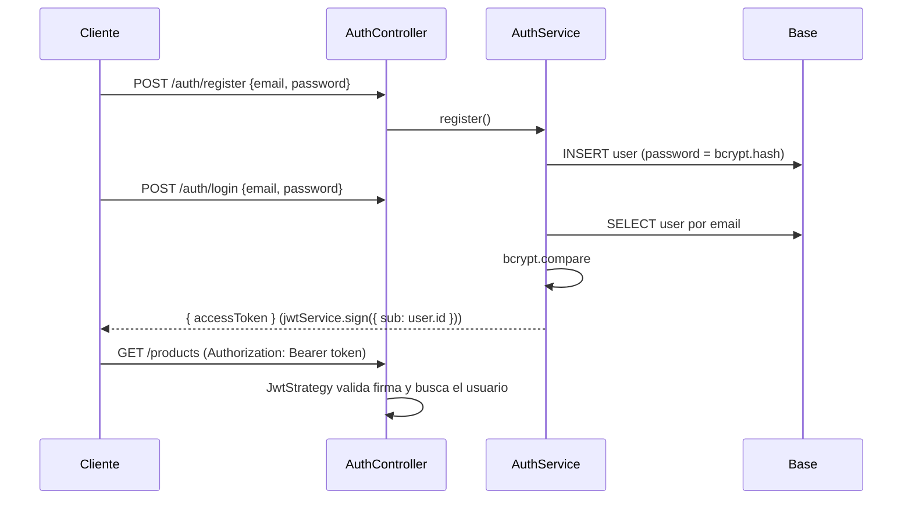

# Passport y JWT propio (lo que no usamos)

<Tech ids={['nestjs']} />

<Estado tipo="concepto">El curso de referencia arma el login completo a mano. Ripopola usa Better Auth, pero esto aparece en muchísimos proyectos y entrevistas, así que tenés que saber cómo funciona.</Estado>

## El flujo



## Las piezas

```bash
pnpm add @nestjs/passport passport passport-jwt @nestjs/jwt bcrypt
```

- **Passport**: librería de Node con "estrategias" de autenticación (JWT,
  local, Google, GitHub…). `@nestjs/passport` la integra como guards.
- **`@nestjs/jwt`**: firma y verifica JWT (`JwtService`).
- **bcrypt**: hashea contraseñas.

### Módulo asíncrono (lo que el curso llama "Módulos asíncronos")

```ts
JwtModule.registerAsync({
  inject: [ConfigService],
  useFactory: (config: ConfigService) => ({
    secret: config.getOrThrow('JWT_SECRET'),
    signOptions: { expiresIn: '2h' },
  }),
}),
```

Es el mismo patrón `forRootAsync`/`registerAsync` que viste en módulos dinámicos.

### La estrategia

```ts
@Injectable()
export class JwtStrategy extends PassportStrategy(Strategy) {
  constructor(config: ConfigService, private readonly prisma: PrismaService) {
    super({
      jwtFromRequest: ExtractJwt.fromAuthHeaderAsBearerToken(),
      secretOrKey: config.getOrThrow('JWT_SECRET'),
    });
  }

  // Se llama con el payload ya verificado. Lo que devuelve va a request.user
  async validate(payload: { sub: string }) {
    const user = await this.prisma.user.findUnique({ where: { id: payload.sub } });
    if (!user || !user.isActive) throw new UnauthorizedException();
    return user;
  }
}
```

Y se protege con `@UseGuards(AuthGuard('jwt'))` (el `AuthGuard` de
`@nestjs/passport`), o globalmente.

### Login

```ts
async login({ email, password }: LoginDto) {
  const user = await this.prisma.user.findUnique({ where: { email }, select: { id: true, password: true } });
  // Mismo error para "no existe" y "contraseña incorrecta": no revelar qué correos están registrados
  if (!user || !(await bcrypt.compare(password, user.password))) {
    throw new UnauthorizedException('Credenciales inválidas');
  }
  return { accessToken: this.jwt.sign({ sub: user.id }) };
}
```

Detalles que el curso trabaja como tareas y que conviene recordar:

- En el payload va el **id**, no el correo (el correo puede cambiar y no es necesario exponerlo).
- `Check AuthStatus`: un endpoint que devuelve el usuario y un token renovado.
- Las contraseñas del seed también se hashean.

## Lo que falta para producción

Lo del curso es una buena base, pero a un sistema de login real le faltan:
refresh tokens con rotación y revocación, verificación de correo,
recuperación de contraseña, bloqueo por intentos (rate limiting), MFA,
login social y auditoría. Es mucho trabajo y mucha superficie de ataque.
Es exactamente lo que Better Auth resuelve en ripopola (temas 2 y 5).

## Tres caminos

| | Hecho a mano (Passport + JWT) | Librería en tu API (Better Auth) | Proveedor externo (Firebase, Auth0) |
| --- | --- | --- | --- |
| Dónde viven los usuarios | Tu base | Tu base | En el proveedor |
| Código que escribís | Todo | Configuración y plugins | Integración |
| Verificación, recuperación, 2FA, social | A mano | Incluidos | Incluidos |
| Costo por usuario | No | No | Puede crecer con el uso |
| Seguridad del núcleo | Tuya | De la librería (open source, auditable) | Del proveedor |
| Operación | Tuya | Tuya (es tu API y tu base) | Del proveedor |

Para ripopola, Better Auth da casi todo lo de un proveedor sin sacar los
usuarios de PostgreSQL. **Passport sigue siendo útil** de todos modos: si
algún día la API tiene que aceptar JWT de terceros (otra app, un
socio), una estrategia `passport-jwt` con `jwks-rsa` los valida con las
claves públicas del emisor.

<Resumen>

- Passport: estrategias como guards; `validate()` devuelve el usuario.
- `@nestjs/jwt` firma y verifica; bcrypt hashea.
- Mismo mensaje de error para usuario inexistente y contraseña incorrecta.
- Un login de producción necesita mucho más; por eso ripopola usa Better Auth.

</Resumen>

## Preguntas de entrevista

**1. ¿Qué es Passport y cómo se integra con Nest?**
Una librería de estrategias de autenticación. `@nestjs/passport` las expone como guards (`AuthGuard('jwt')`); el `validate()` de la estrategia devuelve el usuario que queda en `request.user`.

**2. ¿Qué ponés en el payload de un JWT?**
Lo mínimo: el id del usuario (`sub`), expiración y quizá roles. Nada sensible, porque se puede leer.

**3. ¿Por qué el login devuelve el mismo error si el usuario no existe o la contraseña es incorrecta?**
Para no permitir enumerar qué correos están registrados.

**4. ¿Harías tu propio sistema de login?**
Solo con requisitos que ni una librería ni un proveedor cubran. Si no, una librería madura (Better Auth) o un proveedor resuelven recuperación, MFA, login social y seguridad con mucho menos riesgo.
