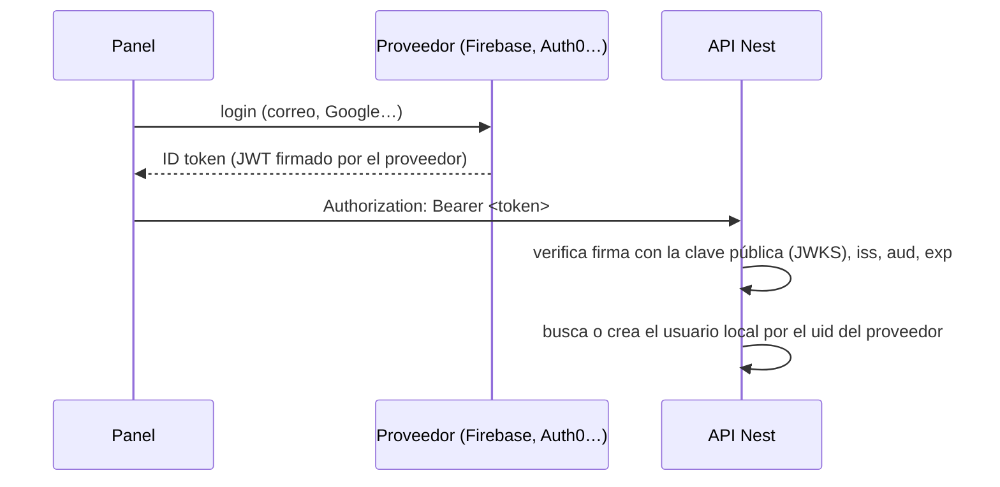

# Firebase Auth, Auth.js y otros proveedores

<Tech ids={['firebase', 'betterauth', 'nestjs']} />

<Estado tipo="concepto">Ripopola usa Better Auth. Estas son las otras opciones que vas a encontrar en el mercado y en entrevistas, con el patrón para integrarlas en Nest.</Estado>

## El patrón de un proveedor externo

Con un proveedor de identidad (*IdP*) externo, el login pasa **fuera de tu
API**. El front recibe un **JWT** del proveedor y lo manda en cada
petición; Nest solo **verifica** ese token:



Diferencias con lo que hace ripopola:

- Sin cookies ni sesiones en tu base: **token en la cabecera** (no hay
  CSRF, pero el token vive en el JavaScript y es más difícil de revocar).
- Necesitás una tabla `users` **espejo** con el `uid` del proveedor, creada
  en la primera petición (*just-in-time provisioning*).

### Verificar cualquier JWT con JWKS

Todos los proveedores OIDC publican sus claves públicas en una URL
(`/.well-known/jwks.json`). Con la librería `jose`:

```ts title="Concepto: verificador genérico"
import { createRemoteJWKSet, jwtVerify } from 'jose';

const JWKS = createRemoteJWKSet(new URL('https://ripopola.eu.auth0.com/.well-known/jwks.json'));

export async function verify(token: string) {
  const { payload } = await jwtVerify(token, JWKS, {
    issuer: 'https://ripopola.eu.auth0.com/',
    audience: 'https://api.ripopola.com',
  });
  return payload; // sub, email, …
}
```

Las claves se descargan una vez y se **cachean**: no hay una llamada de red
por petición. Esto, dentro de un guard global con `@Public()`, es toda la
integración.

## Firebase Authentication

El servicio de identidad de Google, muy usado con Angular (`@angular/fire`)
y con un plan gratuito amplio. Fue la primera opción de ripopola.

```ts title="Concepto: verificar el token de Firebase en Nest"
import { getAuth } from 'firebase-admin/auth';

@Injectable()
export class FirebaseTokenVerifier {
  async verify(authorization?: string) {
    const [scheme, token] = authorization?.split(' ') ?? [];
    if (scheme !== 'Bearer' || !token) throw new UnauthorizedException();
    try {
      return await getAuth().verifyIdToken(token); // firma, exp, iss, aud (el proyecto)
    } catch {
      throw new UnauthorizedException();
    }
  }
}
```

- En Angular, `user.getIdToken()` devuelve el token y lo renueva solo (vence a la hora).
- `firebase-admin` en Cloud Run se autentica con la cuenta de servicio, sin archivos de claves.
- Tiene **emulador local** (`firebase emulators:start --only auth`) para desarrollar sin usuarios reales.
- Roles: *custom claims* dentro del token (rápidos, pero tardan hasta una
  hora en actualizarse) o, mejor, en tu base.

**Por qué ripopola lo cambió por Better Auth**: los usuarios quedaban fuera
de PostgreSQL (tabla espejo y sincronización), las sesiones no se podían
cerrar al instante y la identidad dependía de un tercero.

## Auth.js

**Auth.js** (antes NextAuth.js) es la librería de autenticación más
conocida del mundo Next.js: proveedores OAuth, adaptadores de base de datos
(incluido Prisma) y sesiones. Nació atada a Next y su uso fuera de él
(Express, SvelteKit) es menos maduro; el equipo de Better Auth asumió su
mantenimiento y recomienda Better Auth para proyectos nuevos. Si entrás a
un proyecto con Next.js, es muy probable que lo encuentres.

## Otros proveedores

| Opción | Tipo | Cuándo aparece |
| --- | --- | --- |
| **Auth0** (Okta) | SaaS | Empresas, B2B, SSO corporativo. Muy completo, caro al crecer |
| **Clerk** | SaaS | Startups, componentes de UI listos. Pago por usuario activo |
| **Keycloak** | Open source, autoalojado | Empresas y gobierno; SSO, SAML, LDAP |
| **AWS Cognito** | Gestionado | Proyectos en AWS |
| **Supabase Auth** | Gestionado / open source | Proyectos sobre Supabase, usuarios en PostgreSQL |
| **Passport + JWT** | Hecho a mano | Tema 6 |

## Cómo elegir (y defenderlo en una entrevista)

- **¿Dónde tienen que vivir los usuarios?** En tu base → Better Auth,
  Supabase Auth, Keycloak. Da igual → cualquier SaaS.
- **¿B2B con SSO corporativo (SAML, Azure AD)?** Auth0, Keycloak o WorkOS.
- **¿Costo con 50.000 usuarios?** Las librerías no cobran por usuario; los SaaS sí.
- **¿Quién opera?** Un SaaS te saca operación; una librería la deja en tu API.
- **¿Qué tan difícil es salir?** Migrar usuarios de un proveedor (con
  hashes de contraseñas) puede ser complicado; con tu base, no hay salida que hacer.

Esta comparación es exactamente el ADR de autenticación de ripopola (sección 15).

<Resumen>

- Proveedor externo: el front manda un JWT y Nest lo verifica con JWKS (`jose`).
- Firebase Auth: `verifyIdToken`, emulador, tabla espejo por `uid`.
- Auth.js: estándar en Next.js, menos usado fuera de él.
- Auth0, Clerk, Keycloak, Cognito, Supabase: elegir por dónde viven los usuarios, SSO, costo y operación.

</Resumen>

## Preguntas de entrevista

**1. ¿Qué verifica el backend en un ID token de un proveedor?**
La firma con la clave pública del proveedor (JWKS), el emisor (`iss`), la audiencia (`aud`) y la expiración (`exp`).

**2. ¿Verificar un JWT requiere una llamada de red?**
No en cada petición: las claves públicas se descargan y cachean. Comprobar si fue revocado sí requiere consultar al proveedor.

**3. ¿Qué es JWKS?**
Un documento JSON publicado por el emisor con sus claves públicas, identificadas por `kid`, para que cualquiera pueda verificar sus firmas y para rotar claves sin cortar el servicio.

**4. ¿Qué ventajas y desventajas tiene un proveedor de identidad externo?**
Ventajas: no operar el login y tener resueltos verificación, recuperación, MFA y login social. Desventajas: costo por usuario, dependencia de un tercero, usuarios fuera de tu base y revocación más difícil.

**5. ¿Firebase Auth, Auth0 o Better Auth para un producto nuevo?**
Depende de dónde deban vivir los usuarios, del costo esperado, de si hace falta SSO empresarial y de quién va a operar el sistema. Contá qué elegiste en un proyecto real y por qué.
