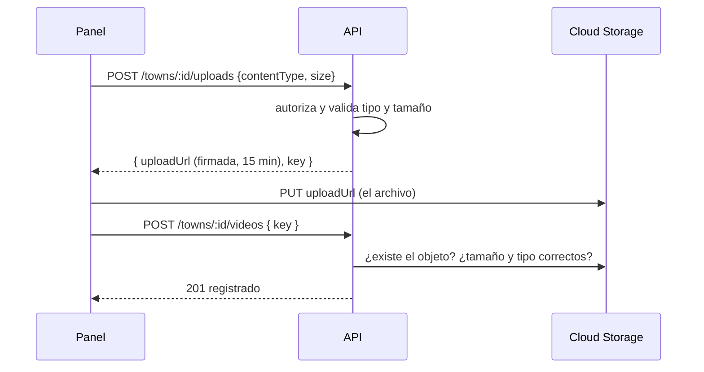

# Subida directa desde el navegador

<Tech ids={['googlecloud', 'nextdotjs', 'nestjs']} />

<Estado tipo="concepto">Para fotos alcanza con pasar por la API. Este patrón se usa cuando lleguen archivos grandes (videos del pueblo, documentos pesados).</Estado>

## El problema

Si un municipio sube un video de 500 MB pasando por la API: ocupa memoria y
una conexión durante minutos, Cloud Run tiene límite de tamaño de petición
(32 MB en HTTP/1) y pagás el tiempo de CPU.

## La solución: URL firmada de escritura



1. La API **autoriza** y genera una URL firmada **de escritura** para una clave concreta.
2. El navegador sube **directo a Cloud Storage**.
3. El navegador avisa a la API, que **verifica** el objeto y lo registra.

```ts
async createUploadUrl(key: string, contentType: string) {
  const [url] = await this.bucket.file(key).getSignedUrl({
    version: 'v4',
    action: 'write',
    expires: Date.now() + 15 * 60 * 1000,
    contentType, // el navegador tiene que mandar exactamente este Content-Type
  });
  return url;
}
```

Detalles importantes:

- Configurar **CORS en el bucket** para permitir el `PUT` desde los orígenes del panel.
- La API decide la **clave** (el cliente no elige dónde escribe).
- Verificar después: tamaño, tipo y que el objeto exista. Lo que no se
  confirma en un tiempo, se borra (regla de ciclo de vida del bucket sobre un prefijo `tmp/`).
- Para procesar lo subido (miniaturas, transcodificar video), un evento de
  Cloud Storage dispara un trabajo.

<Resumen>

- Archivos grandes: el navegador sube directo con una URL firmada de escritura.
- La API autoriza, elige la clave y verifica después.
- CORS en el bucket y limpieza de subidas no confirmadas.

</Resumen>

## Preguntas de entrevista

**1. ¿Cómo permitirías subir archivos de varios GB sin saturar la API?**
Con URLs firmadas de escritura (o subidas reanudables) para que el cliente suba directo al almacenamiento, y la API solo autoriza y registra.

**2. ¿Qué validás después de una subida directa?**
Que el objeto exista en la clave asignada, su tamaño y tipo, y que pertenezca a una solicitud autorizada y vigente.
