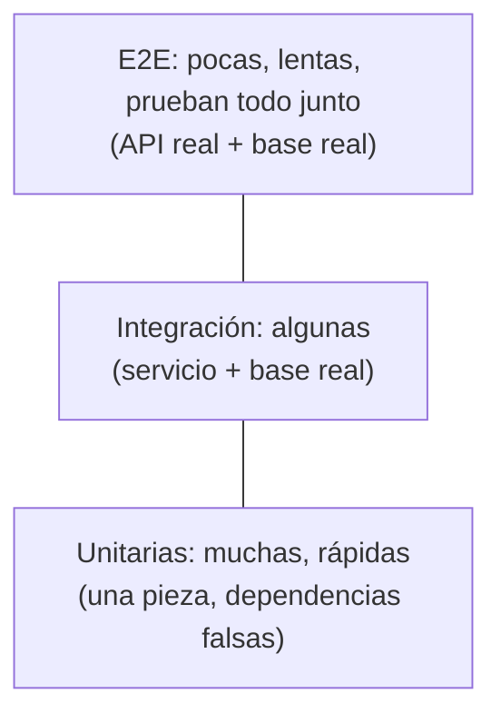

# Pruebas unitarias

<Tech ids={['vitest', 'nestjs', 'nx']} />

<Estado tipo="construye">Pruebas unitarias para la lógica de ripopola: funciones puras (slug, filtros, validación de traducciones), servicios con dobles y guards.</Estado>

## La pirámide



| Nivel | Qué prueba | Velocidad | En ripopola |
| --- | --- | --- | --- |
| Unitaria | Una función o clase aislada | Milisegundos | `slugify`, `buildTownWhere`, `TownPolicy`, guards |
| Integración | Varias piezas reales juntas | Segundos | Consultas de Prisma y PostGIS contra PostgreSQL |
| E2E | La API por HTTP, de punta a punta | Segundos a minutos | `POST /towns` con token, permisos, errores |

En un backend con mucho acceso a datos, las de **integración** valen
muchísimo: un mock de Prisma no te avisa si tu consulta de PostGIS está mal.
Por eso algunos prefieren la forma de "trofeo" (más integración que unitarias).

## Qué probar con unitarias

- **Lógica pura**: transformaciones, cálculos, reglas. Lo más valioso y barato.
- **Decisiones**: guards, políticas de permisos, validaciones.
- **Manejo de errores**: que un caso límite tire la excepción correcta.

Qué **no** probar con unitarias: que Prisma guarda (eso es integración), ni
detalles de implementación (que se llamó a un método interno).

## Herramientas

- **Vitest** (lo usa ripopola; API casi igual a Jest).
- **`@nestjs/testing`**: `Test.createTestingModule()` arma un contenedor de
  Nest con los providers que elijas, y `overrideProvider()` reemplaza los que quieras.

```bash
pnpm exec nx test api              # todas
pnpm exec nx test api --watch      # al guardar
pnpm exec nx test api -- town-policy  # solo las que coinciden
```

## En ripopola

### 1. Funciones puras: tablas de casos

```ts title="towns/town-filters.spec.ts"
import { buildTownWhere } from './town-filters';

describe('buildTownWhere', () => {
  it('siempre filtra por publicados', () => {
    expect(buildTownWhere({})).toMatchObject({ status: 'PUBLISHED' });
  });

  it('arma el rango de población solo con lo que vino', () => {
    expect(buildTownWhere({ minPopulation: 100 }).population).toEqual({ gte: 100, lte: undefined });
    expect(buildTownWhere({}).population).toBeUndefined();
  });

  it('busca etiquetas con hasEvery', () => {
    expect(buildTownWhere({ tags: ['río'] }).tags).toEqual({ hasEvery: ['río'] });
  });
});
```

### 2. Una política de permisos (la más importante)

```ts title="auth/town-policy.spec.ts"
describe('TownPolicy', () => {
  const prisma = { town: { findUnique: vi.fn() } };
  const policy = new TownPolicy(prisma as unknown as PrismaService);
  const user = (role?: 'ADMIN' | 'EDITOR', org = 'org-1'): AuthUser => ({
    id: 'u', email: 'e', name: 'n', sessionId: 's', platformRole: 'USER',
    memberships: role ? [{ organizationId: org, role }] : [],
  });

  beforeEach(() => prisma.town.findUnique.mockResolvedValue({ organizationId: 'org-1' }));

  it.each([
    ['ADMIN', 'publish', true],
    ['EDITOR', 'edit', true],
    ['EDITOR', 'publish', false],
  ] as const)('%s puede %s: %s', async (role, action, allowed) => {
    const result = policy.assert(user(role), action, 'town-1');
    if (allowed) await expect(result).resolves.toBeUndefined();
    else await expect(result).rejects.toBeInstanceOf(ForbiddenException);
  });

  it('un admin de OTRO ayuntamiento no puede editar', async () => {
    await expect(policy.assert(user('ADMIN', 'org-2'), 'edit', 'town-1')).rejects.toBeInstanceOf(ForbiddenException);
  });
});
```

Esa última prueba es la que te salva de BOLA (sección 6).

### 3. Un servicio con `createTestingModule`

```ts
const module = await Test.createTestingModule({
  providers: [TownsService, TownPolicy, { provide: PrismaService, useValue: prismaMock }],
})
  .overrideProvider(TownPolicy)
  .useValue({ assert: vi.fn() })
  .compile();
```

## Buenas prácticas

- **Una idea por prueba**, con un nombre que diga el comportamiento ("da 404 si no está publicado").
- **Arrange, Act, Assert**: preparar, ejecutar, comprobar.
- **Probar comportamiento, no implementación**: si refactorizás sin cambiar
  el comportamiento, las pruebas no deberían romperse.
- **Datos de prueba con *factories*** (`aTown({ status: 'DRAFT' })`) en vez de objetos gigantes copiados.
- **Cobertura** como señal, no como objetivo: 100 % de cobertura con
  aserciones pobres no prueba nada.

<Angular>

Es lo mismo que `TestBed.configureTestingModule` en Angular:
`Test.createTestingModule` + `overrideProvider` es casi idéntico a
`TestBed` + `{ provide: X, useValue: mock }`. Lo que ya sabés de testing de
servicios en Angular se aplica directo.

</Angular>

<Resumen>

- Unitarias para lógica pura y decisiones (permisos); integración para la base.
- `Test.createTestingModule` + `overrideProvider` para aislar.
- Probar comportamiento, no implementación.

</Resumen>

## Preguntas de entrevista

**1. ¿Qué es la pirámide de pruebas?**
Muchas unitarias rápidas, algunas de integración y pocas e2e, porque cuanto más alto, más lentas y frágiles.

**2. ¿Mockearías la base de datos?**
En unitarias de lógica, sí. Pero las consultas se prueban con integración contra una base real, porque un mock no detecta errores de SQL.

**3. ¿Cómo reemplazás un provider en una prueba de Nest?**
Con `useValue`/`useClass` en `createTestingModule` o con `overrideProvider().useValue()`.

**4. ¿Qué significa "probar comportamiento y no implementación"?**
Que la prueba verifica entradas y salidas observables, no cómo se calcula por dentro, para que sobreviva a refactorizaciones.
