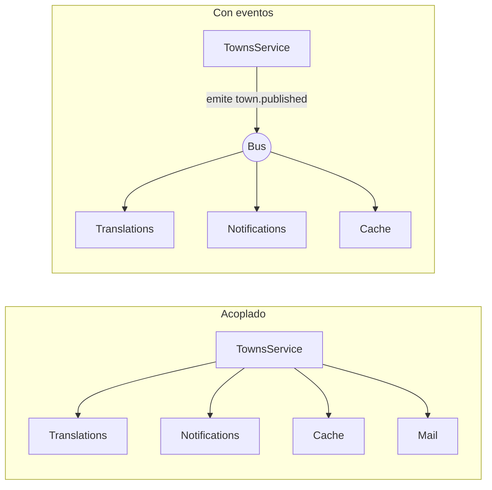

# Eventos internos con EventEmitter

<Tech ids={['nestjs']} />

<Estado tipo="construye">Eventos de dominio en ripopola: "pueblo publicado", "texto del municipio cambiado", "llegó un contacto". Los escuchan las traducciones, las notificaciones y la limpieza de archivos, sin que el módulo de pueblos los conozca.</Estado>

## Concepto

Cuando un municipio publica su pueblo, pasan varias cosas: hay que traducir
textos, avisar por WebSocket, invalidar la caché, quizá mandar un correo. Si
`TownsService` llama a cada servicio, termina dependiendo de todo:



Con un **evento**, `TownsService` solo anuncia "se publicó un pueblo".
Quien quiera, escucha. Agregar una reacción nueva no toca el módulo de pueblos.
Esto rompe dependencias circulares entre módulos (sección 1, `forwardRef`).

| Llamada directa | Evento |
| --- | --- |
| Necesito el resultado para seguir | Es una consecuencia, no necesito respuesta |
| Si falla, la operación tiene que fallar | Si falla, la operación principal igual vale |
| Uno sabe del otro | El emisor no conoce a los oyentes |

<Angular>

Es como un `Subject` de RxJS en un servicio compartido, o un `output()` de
un componente: el emisor no sabe quién escucha. En Nest el bus es
`EventEmitter2` y los oyentes se declaran con un decorador.

</Angular>

## En ripopola

### 1. Instalar y registrar

```bash
pnpm add -E @nestjs/event-emitter
```

```ts title="app.module.ts"
imports: [EventEmitterModule.forRoot({ wildcard: true, delimiter: '.' })]
```

### 2. Definir los eventos como clases

```ts title="towns/events.ts"
export class TownPublishedEvent {
  static readonly event = 'town.published';
  constructor(readonly townId: string, readonly publishedBy: string) {}
}

export class TownTextChangedEvent {
  static readonly event = 'town.text-changed';
  constructor(readonly townId: string, readonly fields: string[]) {}
}
```

Clases (no strings sueltos): un solo lugar con el nombre y los datos tipados.

### 3. Emitir

```ts title="towns.service.ts"
constructor(private readonly prisma: PrismaService, private readonly events: EventEmitter2) {}

async publish(user: AuthUser, id: string) {
  await this.policy.assert(user, 'publish', id);
  const town = await this.prisma.town.update({ where: { id }, data: { status: 'PUBLISHED' }, select: TOWN_SUMMARY });
  this.events.emit(TownPublishedEvent.event, new TownPublishedEvent(id, user.id));
  return town;
}
```

**Emitir después de guardar**: si el `update` falla, no se anuncia nada.

### 4. Escuchar

```ts title="translations/translations.listener.ts"
@Injectable()
export class TranslationsListener {
  constructor(private readonly translations: TranslationsService) {}

  @OnEvent(TownTextChangedEvent.event, { async: true })
  async onTextChanged(event: TownTextChangedEvent) {
    await this.translations.enqueue('town', event.townId, event.fields); // a la cola (tema 3)
  }
}
```

Por defecto los oyentes corren **sincrónicamente** dentro de `emit`. Con
`{ async: true }` no bloquean, pero un error queda sin manejar: siempre
`try/catch` y log adentro, o el error puede tumbar el proceso.

## Los límites (importante)

Los eventos de `EventEmitter2` viven **en la memoria del proceso**:

- Si la instancia de Cloud Run se apaga justo después de emitir, **el evento se pierde**.
- Otra instancia **no se entera**.
- No hay reintentos.

Por eso, para lo que **no se puede perder** (traducir, mandar un correo), el
oyente solo **encola un trabajo persistente** (BullMQ, tema 3), que sí
sobrevive y se reintenta. Para lo que puede perderse sin drama (invalidar una
caché local), alcanza con el evento.

:::info El patrón outbox
La garantía completa es el **transactional outbox**: guardar el evento en una
tabla `outbox` **en la misma transacción** que el cambio, y un proceso aparte
lo publica. Así nunca hay un cambio sin su evento ni un evento sin su
cambio. Es la pregunta "senior" sobre eventos.
:::

<Resumen>

- Eventos para consecuencias que no necesitan respuesta; desacoplan módulos.
- Emitir después de guardar, con clases tipadas.
- `EventEmitter2` es en memoria: lo importante va a una cola persistente.
- Outbox para garantía total.

</Resumen>

## Preguntas de entrevista

**1. ¿Cuándo usarías un evento en vez de llamar a otro servicio?**
Cuando es una consecuencia que no necesita respuesta y cuyo fallo no debe hacer fallar la operación principal, o para romper dependencias entre módulos.

**2. ¿Qué problema tienen los eventos en memoria?**
Se pierden si el proceso muere, no llegan a otras instancias y no se reintentan.

**3. ¿Qué es el patrón outbox?**
Guardar el evento en una tabla dentro de la misma transacción que el cambio de datos, y publicarlo después desde esa tabla, para garantizar consistencia entre datos y eventos.
