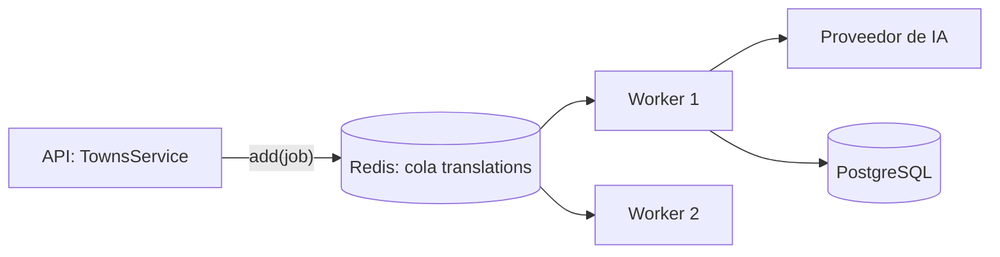

# Colas con BullMQ y Redis

<Tech ids={['redis', 'nestjs', 'docker', 'googlecloud']} />

<Estado tipo="construye">La cola `translations` de ripopola: cada cambio de texto de un municipio encola un trabajo que traduce con IA, con reintentos, límite de velocidad y presupuesto.</Estado>

## Concepto

Una **cola de trabajos** separa **pedir** algo de **hacerlo**:



- El **productor** (la API) agrega un trabajo y responde enseguida (202 o 200).
- El **worker** lo procesa cuando puede, con reintentos si falla.
- La cola es **persistente** (Redis): si un worker muere, otro lo retoma.

Sirve para todo lo **lento, poco confiable o caro**: IA, correos, procesar
imágenes, importaciones, llamadas a APIs externas.

**BullMQ** es la librería de colas más usada en Node, sobre **Redis**, y
Nest la integra con `@nestjs/bullmq`.

## En ripopola

### 1. Redis en Docker Compose

```yaml title="compose.yaml (agregar el servicio)"
services:
  redis:
    image: redis:8-alpine
    ports: ['6379:6379']
    command: ['redis-server', '--appendonly', 'yes', '--maxmemory-policy', 'noeviction']
    volumes: [redis-data:/data]

volumes:
  redis-data:
```

- `appendonly yes`: persiste en disco (que los trabajos no se pierdan al reiniciar).
- `noeviction`: BullMQ **lo exige**. Si Redis se llena, que falle en vez de borrar trabajos en silencio.

```bash
docker compose up -d redis
```

:::info Versión de Redis
Usá la última estable al momento de instalar (regla D-04) y fijala en
`compose.yaml`. Valkey (el fork open source de Redis) es compatible con BullMQ.
:::

### 2. Instalar y configurar

```bash
pnpm add -E @nestjs/bullmq bullmq
```

```ts title="app.module.ts"
BullModule.forRootAsync({
  inject: [ConfigService],
  useFactory: (config: ConfigService) => ({
    connection: { url: config.getOrThrow('REDIS_URL') },
    defaultJobOptions: {
      attempts: 5,
      backoff: { type: 'exponential', delay: 5_000 },  // 5 s, 10 s, 20 s…
      removeOnComplete: { age: 24 * 3600, count: 1000 },
      removeOnFail: { age: 7 * 24 * 3600 },            // los fallidos, una semana para investigar
    },
  }),
}),
```

### 3. Registrar la cola y el productor

```ts title="translations/translations.module.ts"
@Module({
  imports: [BullModule.registerQueue({ name: 'translations' }), AiModule],
  providers: [TranslationsService, TranslationsProcessor, TranslationsListener],
})
export class TranslationsModule {}
```

```ts title="translations/translations.service.ts"
export interface TranslateJob {
  entityType: 'town';
  entityId: string;
  field: string;
  locale: string;
}

@Injectable()
export class TranslationsService {
  constructor(@InjectQueue('translations') private readonly queue: Queue<TranslateJob>) {}

  async enqueue(entityType: 'town', entityId: string, fields: string[]) {
    const locales = ['it', 'en']; // los idiomas destino se configuran
    await this.queue.addBulk(
      fields.flatMap((field) =>
        locales.map((locale) => ({
          name: 'translate',
          data: { entityType, entityId, field, locale },
          // jobId determinístico: si ya hay uno pendiente igual, no se duplica
          opts: { jobId: `${entityType}:${entityId}:${field}:${locale}` },
        })),
      ),
    );
  }
}
```

El **`jobId` determinístico** hace la cola idempotente: si el municipio
guarda tres veces seguidas, hay un solo trabajo pendiente por campo e idioma.

### 4. El worker

```ts title="translations/translations.processor.ts"
import { Processor, WorkerHost, OnWorkerEvent } from '@nestjs/bullmq';
import { DelayedError, Job, UnrecoverableError } from 'bullmq';

@Processor('translations', {
  concurrency: 4,                         // 4 trabajos a la vez por worker
  limiter: { max: 30, duration: 60_000 }, // máx. 30 por minuto (límite del proveedor de IA)
})
export class TranslationsProcessor extends WorkerHost {
  private readonly logger = new Logger(TranslationsProcessor.name);

  constructor(
    private readonly prisma: PrismaService,
    @Inject(TRANSLATION_PROVIDER) private readonly ai: TranslationProvider,
    private readonly budget: AiBudgetService,
  ) {
    super();
  }

  async process(job: Job<TranslateJob>) {
    const { entityId, field, locale } = job.data;

    if (!(await this.budget.hasRoom())) {
      // Sin presupuesto: reprogramar para mañana en vez de fallar
      await job.moveToDelayed(this.budget.nextResetAt().getTime(), job.token);
      throw new DelayedError();
    }

    const original = await this.loadOriginal(entityId, field);
    if (!original) throw new UnrecoverableError('El texto ya no existe'); // no reintentar

    const hash = sha256(original.text);
    const existing = await this.findTranslation(entityId, field, locale);
    if (existing?.status === 'human' || existing?.sourceHash === hash) return 'skip';

    const result = await this.ai.translate({ text: original.text, from: original.locale, to: locale });
    const problems = checkTranslation(original.text, result.text);

    await this.saveTranslation({ entityId, field, locale, hash, text: result.text, status: problems.length ? 'needs_review' : 'machine' });
    await this.budget.record(result.inputTokens, result.outputTokens);
    return problems.length ? 'needs_review' : 'ok';
  }

  @OnWorkerEvent('failed')
  onFailed(job: Job, err: Error) {
    this.logger.error(`Traducción ${job.id} falló (intento ${job.attemptsMade}): ${err.message}`);
  }
}
```

Qué mirar:

- Un error normal → BullMQ **reintenta** con backoff. `UnrecoverableError` → no reintenta.
- **Idempotencia**: si el trabajo corre dos veces, el hash hace que la segunda no gaste.
- `limiter` respeta los límites de velocidad del proveedor.
- El presupuesto **pausa**, no pierde trabajos.

### 5. Ver la cola: Bull Board

```bash
pnpm add -E @bull-board/nestjs @bull-board/api @bull-board/express
```

Monta un panel web (en `/api/internal/queues`, protegido) con los trabajos
pendientes, activos, fallidos y la opción de reintentar a mano.

## ¿Dónde corre el worker en producción?

Este es el punto más delicado con **Cloud Run**:

- Por defecto, Cloud Run asigna CPU **solo durante las peticiones HTTP**. Un
  worker de BullMQ necesita CPU **todo el tiempo** para escuchar la cola.
- Opciones:
  1. **Mismo servicio con "CPU siempre asignada"** (*instance-based billing*) y mínimo 1 instancia. Simple; cuesta tener una instancia siempre prendida.
  2. **Un servicio worker aparte** (misma imagen, otro comando: `node dist/worker.js` que crea la app con `NestFactory.createApplicationContext`, sin HTTP). Escala distinto que la API.
  3. **Sin worker permanente**: Cloud Tasks llama a un endpoint por trabajo (escala a cero, pero sin BullMQ).

La decisión depende del costo y se toma en la sección 14 junto con el
proveedor de Redis. El código de la cola no cambia en ninguna de las opciones 1 y 2.

<Alternativa title="RabbitMQ, SQS, Pub/Sub, Cloud Tasks y pg-boss">

**RabbitMQ** (mensajería con colas y enrutamiento, `@nestjs/microservices`),
**AWS SQS** y **Google Pub/Sub** (colas gestionadas), **Cloud Tasks**
(una petición HTTP por tarea, escala a cero) y **pg-boss** (colas sobre
PostgreSQL, sin Redis). BullMQ es el estándar de facto en el ecosistema Nest
y Redis además sirve a ripopola para caché, rate limiting y WebSockets.

</Alternativa>

<Resumen>

- Cola = pedir ahora, hacer después, con persistencia y reintentos.
- BullMQ sobre Redis (`noeviction`, persistente).
- `jobId` determinístico + hash = idempotencia.
- `concurrency`, `limiter`, `UnrecoverableError`, Bull Board.
- En Cloud Run el worker necesita CPU siempre asignada o un servicio aparte.

</Resumen>

## Preguntas de entrevista

**1. ¿Para qué sirve una cola de trabajos?**
Para sacar de la petición el trabajo lento o poco confiable, procesarlo en segundo plano con reintentos y absorber picos.

**2. ¿Cómo hacés idempotente un trabajo?**
Con ids de trabajo determinísticos para no duplicar, y lógica que detecta si ya se hizo (hash, estado) antes de actuar.

**3. ¿Qué es un trabajo "envenenado" y cómo lo tratás?**
Uno que falla siempre. Se limita el número de intentos, se marca como fallido (dead letter) y se investiga; los errores permanentes no se reintentan.

**4. ¿Qué cuidado tenés al correr workers en una plataforma serverless?**
Que tengan CPU fuera de las peticiones (CPU siempre asignada o servicio dedicado) o usar un modelo push como Cloud Tasks.

**5. ¿Por qué BullMQ exige `noeviction` en Redis?**
Porque si Redis expulsa claves para liberar memoria, se pierden trabajos sin aviso.
