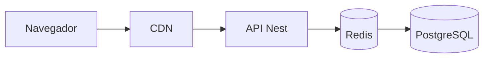
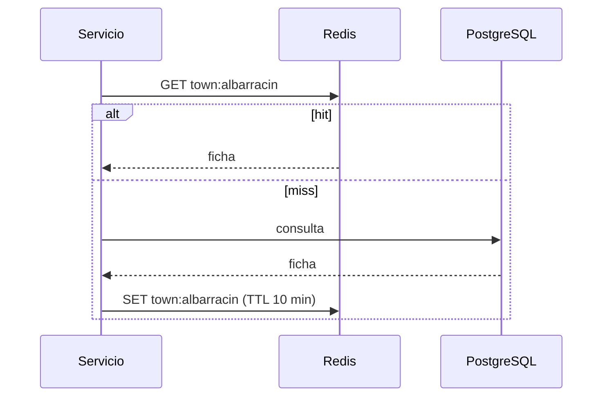

# Caché con Redis

<Tech ids={['redis', 'nestjs', 'googlecloud']} />

<Estado tipo="construye">Caché de la ficha de cada pueblo y de las búsquedas más comunes en Redis, invalidada cuando el municipio guarda cambios, y cabeceras HTTP para que el navegador y la CDN también cacheen.</Estado>

## Niveles de caché



| Nivel | Qué cachea | Cómo |
| --- | --- | --- |
| Navegador | Respuestas que el usuario ya pidió | `Cache-Control`, `ETag` |
| CDN | Respuestas públicas para todos | `Cache-Control: public, s-maxage` |
| Aplicación (Redis) | Resultados de consultas caras | `cache-manager` |
| Base de datos | Páginas en memoria | PostgreSQL lo hace solo |

Cuanto más cerca del usuario, más rápido y barato, pero más difícil de invalidar.

> "Hay solo dos cosas difíciles en informática: invalidar cachés y ponerle nombre a las cosas."

## Cache-aside

El patrón más común: **leer de la caché; si no está, de la base, y guardar**.



## En ripopola

### 1. Instalar

```bash
pnpm add -E @nestjs/cache-manager cache-manager @keyv/redis
```

```ts title="app.module.ts"
CacheModule.registerAsync({
  isGlobal: true,
  inject: [ConfigService],
  useFactory: (config: ConfigService) => ({
    stores: [createKeyv(config.getOrThrow('REDIS_URL'), { namespace: 'cache' })],
    ttl: 10 * 60 * 1000, // 10 minutos por defecto (milisegundos)
  }),
}),
```

### 2. Cache-aside en el servicio

```ts title="towns.service.ts"
constructor(
  private readonly prisma: PrismaService,
  @Inject(CACHE_MANAGER) private readonly cache: Cache,
) {}

async findBySlug(slug: string): Promise<TownDetail> {
  const key = `town:${slug}`;
  const cached = await this.cache.get<TownDetail>(key);
  if (cached) return cached;

  const town = await this.loadDetail(slug); // la consulta de siempre (404 si no existe)
  await this.cache.set(key, town);
  return town;
}
```

### 3. Invalidar con eventos

Cuando el municipio guarda, la ficha cacheada queda vieja. El evento de la
sección 10 la borra:

```ts title="towns/towns-cache.listener.ts"
@Injectable()
export class TownsCacheListener {
  constructor(@Inject(CACHE_MANAGER) private readonly cache: Cache) {}

  @OnEvent('town.*') // published, updated, text-changed…
  async invalidate(event: { slug: string }) {
    await this.cache.del(`town:${event.slug}`);
  }
}
```

Como la caché está en **Redis** (compartida), borrarla en una instancia
sirve para todas. Con una caché en memoria por instancia, las demás seguirían
sirviendo la versión vieja hasta el TTL.

### 4. El interceptor de caché (para casos simples)

Nest trae `CacheInterceptor`, que cachea respuestas `GET` por URL:

```ts
@UseInterceptors(CacheInterceptor)
@CacheTTL(60_000)
@Public()
@Get('stats/regions')
regions() { ... }
```

Útil para datos públicos que pueden estar un poco desactualizados. Ojo:
**nunca** en endpoints que dependen del usuario (cachearía la respuesta de
uno para todos).

### 5. Caché HTTP

Para las fichas públicas, que el navegador y la CDN también ayuden:

```ts
@Header('Cache-Control', 'public, max-age=60, s-maxage=300, stale-while-revalidate=600')
@Public()
@Get(':slug')
findOne() { ... }
```

- `max-age=60`: el navegador la reusa 1 minuto.
- `s-maxage=300`: la CDN, 5 minutos.
- `stale-while-revalidate`: sirve la vieja mientras pide la nueva en segundo plano.

Express agrega **ETag** solo: si el contenido no cambió, el navegador recibe
un **304 Not Modified** sin cuerpo.

## Cuándo no cachear

- Datos que cambian en cada petición o son por usuario (salvo con clave por usuario y cuidado).
- Cuando la consulta ya es rápida: agregar caché suma complejidad y bugs de datos viejos.
- Datos donde un valor viejo es grave (permisos, saldos).

<Resumen>

- Varios niveles: navegador, CDN, Redis, base.
- Cache-aside con TTL, invalidado por eventos.
- Redis compartido para que la invalidación llegue a todas las instancias.
- Nunca cachear respuestas por usuario con claves globales.

</Resumen>

## Preguntas de entrevista

**1. ¿Qué es cache-aside?**
La aplicación busca en la caché y, si no está, lee de la base y la guarda. La caché no sabe nada de la base.

**2. ¿Cómo invalidás una caché?**
Con TTL (expira sola), borrando la clave al cambiar el dato (por eventos), o versionando las claves.

**3. ¿Caché en memoria o Redis?**
En memoria es más rápida pero por instancia: con varias instancias quedan inconsistentes. Redis es compartida.

**4. ¿Qué significan `max-age` y `s-maxage`?**
Cuánto puede reusar la respuesta el navegador y cuánto una caché compartida (CDN).

**5. ¿Qué es un cache stampede y cómo lo evitás?**
Muchas peticiones que no encuentran la clave a la vez y golpean la base juntas. Se evita con un bloqueo para que solo una recalcule, TTL con variación aleatoria o `stale-while-revalidate`.
