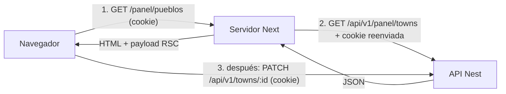

# Next.js consumiendo la API de Nest

<Tech ids={['nextdotjs', 'react', 'nestjs', 'betterauth']} />

<Estado tipo="construye">La web y el panel de ripopola en Next.js hablando con la API: lecturas en Server Components con la sesión del usuario, interacción en el navegador con TanStack Query y un solo manejo de errores.</Estado>

:::info Alcance de este tema
Acá va lo necesario para integrar Next con Nest. React y Next en
profundidad (componentes, estado, formularios, estilos) están en el curso
de React y Next de ripopola.
:::

## Concepto: Next llama a la API desde dos lugares

En Angular, todo `HttpClient` corre en el navegador (salvo el SSR). En
Next con App Router hay **dos entornos**, y la API se llama desde los dos:

| Desde | Qué es | Cómo viaja la sesión |
| --- | --- | --- |
| **Servidor de Next** (Server Components, Server Actions, Route Handlers, `proxy.ts`) | Node, en Cloud Run | Next la **reenvía**: lee la cookie de la petición con `cookies()` y la pone en el `fetch` |
| **Navegador** (Client Components, `'use client'`) | El JavaScript del usuario | La cookie `HttpOnly` va sola (`credentials: 'include'`) |



Regla práctica en ripopola: **leer en el servidor** (Server Components),
**interactuar desde el navegador** (Client Components con TanStack Query) o
con Server Actions para formularios simples.

<Angular>

`proxy.conf.json` → `rewrites` en `next.config.ts`. `HttpClient` +
interceptores → una función `fetch` envuelta (no hay interceptores). El
`resolver` de una ruta → un Server Component `async` que espera los datos
antes de renderizar. `httpResource` → `useQuery` de TanStack Query.

</Angular>

## En ripopola

### 1. Desarrollo: mismo origen con rewrites

```ts title="apps/panel/next.config.ts"
import type { NextConfig } from 'next';

const nextConfig: NextConfig = {
  cacheComponents: true,
  partialPrefetching: true,
  async rewrites() {
    // El navegador ve todo en localhost:4300; Next reenvía /api/* a Nest
    return [{ source: '/api/:path*', destination: `${process.env.API_INTERNAL_URL}/api/:path*` }];
  },
};

export default nextConfig;
```

Igual que el proxy de Angular: sin CORS en desarrollo, y la cookie de
Better Auth queda en el origen del panel. Los rewrites reenvían cabeceras
y `Set-Cookie` en los dos sentidos, así que el login funciona igual.

### 2. El cliente tipado, una vez para los dos lados

Con los tipos generados desde OpenAPI (sección 8) y **openapi-fetch**, un
cliente mínimo que conoce cada ruta, sus parámetros y su respuesta:

```bash
pnpm add -E openapi-fetch
```

```ts title="libs/frontend/api/src/client.ts"
import createClient from 'openapi-fetch';
import type { paths } from '@ripopola/api-client';

export function createApi(baseUrl: string, init?: { headers?: HeadersInit; credentials?: RequestCredentials }) {
  return createClient<paths>({ baseUrl, ...init });
}
```

### 3. En el servidor: reenviar la cookie

```ts title="libs/frontend/api/src/server.ts"
import 'server-only';                         // si alguien lo importa en un Client Component, el build falla
import { cookies } from 'next/headers';
import { createApi } from './client';

export async function serverApi() {
  const cookieStore = await cookies();
  return createApi(process.env.API_INTERNAL_URL!, {
    headers: { cookie: cookieStore.toString() },   // la sesión del usuario, tal cual llegó
  });
}
```

```tsx title="apps/panel/app/pueblos/page.tsx"
import { redirect } from 'next/navigation';
import { serverApi } from '@ripopola/frontend-api/server';

export default async function TownsPage({ searchParams }: PageProps<'/pueblos'>) {
  const { page = '1' } = await searchParams;
  const api = await serverApi();
  const { data, response } = await api.GET('/api/v1/panel/towns', {
    params: { query: { page: Number(page) } },
  });
  if (response.status === 401) redirect('/login');
  if (!data) throw new Error('No se pudieron cargar los pueblos'); // lo atrapa error.tsx

  return <TownsTable towns={data.items} total={data.total} />;
}
```

Qué mirar:

- **`API_INTERNAL_URL`**: el servidor de Next llama a la API directo (por
  la red interna de Cloud Run), sin pasar por el navegador ni por CORS.
- **`cookies()` hace dinámica la página**: con Cache Components, Next la
  renderiza en cada petición (lo esperable en un panel con datos del
  usuario). Lo público y cacheable va en el tema 2.
- **`server-only`** evita que este archivo (que lee cookies y conoce la URL
  interna) termine en el JavaScript del navegador.
- `data` está tipado desde OpenAPI: si la API cambia, el compilador marca
  el componente.
- El guard global de Nest (sección 6) sigue siendo la autoridad: si la
  sesión venció, la API responde 401 y Next redirige.

### 4. En el navegador: TanStack Query

```ts title="libs/frontend/api/src/browser.ts"
import { createApi } from './client';

// '' = mismo origen en desarrollo (rewrites); https://api.ripopola.com en producción
export const browserApi = createApi(process.env.NEXT_PUBLIC_API_URL ?? '', { credentials: 'include' });
```

```tsx title="apps/panel/app/pueblos/[id]/publish-button.tsx"
'use client';

export function PublishButton({ townId }: { townId: string }) {
  const queryClient = useQueryClient();
  const publish = useMutation({
    mutationFn: async () => {
      const { data, error } = await browserApi.POST('/api/v1/towns/{id}/publish', { params: { path: { id: townId } } });
      if (error) throw new ApiError(error);                    // Problem Details de la API
      return data;
    },
    onSuccess: () => queryClient.invalidateQueries({ queryKey: ['towns'] }),
    onError: (e) => toast.error(e instanceof ApiError ? e.problem.title : 'Error inesperado'),
  });
  return <button onClick={() => publish.mutate()} disabled={publish.isPending}>Publicar</button>;
}
```

- **`credentials: 'include'`** es el `withCredentials` de Angular: sin eso,
  una petición a otro origen no manda la cookie de sesión. En producción,
  la API acepta ese origen con `credentials: true` en CORS (sección 6).
- **Nunca** pongas credenciales en variables `NEXT_PUBLIC_*`: todo lo que
  empieza así termina en el JavaScript del navegador.

### 5. Un solo manejo de errores

La API responde siempre **Problem Details** (sección 8). Del lado de Next,
una clase y dos lugares:

```ts title="libs/frontend/api/src/api-error.ts"
export interface Problem { type: string; title: string; status: number; detail?: string; errors?: Record<string, string[]> }

export class ApiError extends Error {
  constructor(readonly problem: Problem) {
    super(problem.title);
  }
}
```

- **Servidor**: un `error.tsx` por sección muestra el error de la página;
  un 401 se convierte en `redirect('/login')` y un 404 en `notFound()`.
- **Navegador**: el `onError` de cada mutación (o uno global en el
  `QueryClient`) muestra `problem.title` y, en formularios, `problem.errors`
  junto a cada campo. El `409` del bloqueo optimista (sección 3) pide recargar.

### 6. Server Actions contra Nest

Para formularios simples del panel, una **Server Action** evita escribir el
`useMutation`:

```ts title="apps/panel/app/pueblos/[id]/actions.ts"
'use server';

export async function updateDescription(townId: string, formData: FormData) {
  const api = await serverApi();                                // reenvía la cookie
  const { error } = await api.PATCH('/api/v1/towns/{id}', {
    params: { path: { id: townId } },
    body: { description: String(formData.get('description')) },
  });
  if (error) return { error };                                  // el formulario lo muestra
  updateTag(`town:${townId}`);                                   // tema 2
}
```

:::warning Lo que una Server Action no hace
Si Nest responde con un `Set-Cookie`, ese cookie le llega al **servidor de
Next**, no al navegador. Por eso todo lo que crea o cambia la sesión
(login, logout, 2FA) va **desde el navegador** con el cliente de Better
Auth (sección 6), nunca por una Server Action que llame a Nest.
:::

<Alternativa title="Que Next sea el backend">

Next puede tener su propia API (**Route Handlers**, Server Actions) y hasta
usar Prisma directamente, sin Nest. Es muy común en proyectos chicos y en
el curso de referencia de Next. Ripopola mantiene a Nest como **única API**
porque la usan la web, el panel, los workers de BullMQ, los WebSockets y,
el día de mañana, una app móvil; Next queda como *Backend for Frontend*:
renderiza, cachea y reenvía la sesión, pero las reglas de negocio están en
un solo lugar.

</Alternativa>

<Resumen>

- Next llama a la API desde el servidor (reenviando la cookie con `cookies()`) y desde el navegador (`credentials: 'include'`).
- `rewrites` en desarrollo: mismo origen, como el proxy de Angular.
- Un cliente tipado con `openapi-fetch` para los dos lados; `server-only` para lo del servidor.
- Leer en Server Components, interactuar con TanStack Query o Server Actions.
- Problem Details → `ApiError`, `error.tsx`, `redirect` y `notFound`.
- La sesión se crea y se cierra desde el navegador, no desde Server Actions.

</Resumen>

## Preguntas de entrevista

**1. ¿Cómo hace un Server Component para llamar a una API protegida con la sesión del usuario?**
Lee las cookies de la petición entrante (`cookies()`) y las reenvía en el `fetch` a la API. La API valida la sesión como con cualquier otra petición.

**2. ¿Qué diferencia hay entre llamar a la API desde un Server Component y desde un Client Component?**
El Server Component corre en el servidor de Next: puede usar URLs internas y secretos, no tiene CORS y su resultado llega como HTML. El Client Component corre en el navegador: depende de CORS, de que la cookie viaje con `credentials: 'include'` y de no exponer secretos.

**3. ¿Qué es `server-only` y para qué sirve?**
Un paquete que hace fallar el build si un módulo pensado para el servidor se importa en código del cliente. Evita filtrar secretos o lógica de servidor al navegador.

**4. ¿Por qué no hacer el login con una Server Action que llama a otra API?**
Porque el `Set-Cookie` de esa API le llega al servidor de Next y no al navegador; habría que copiarlo a mano. Es más simple y seguro que el navegador hable con el servicio de auth.

**5. ¿Cuándo usarías Next como backend y cuándo una API aparte?**
Next alcanza para un producto con un solo frontend y lógica simple. Una API aparte conviene cuando hay varios clientes, procesos en segundo plano, tiempo real o un dominio con reglas que no deben vivir en el frontend.
