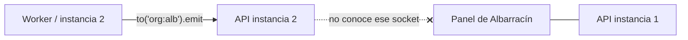
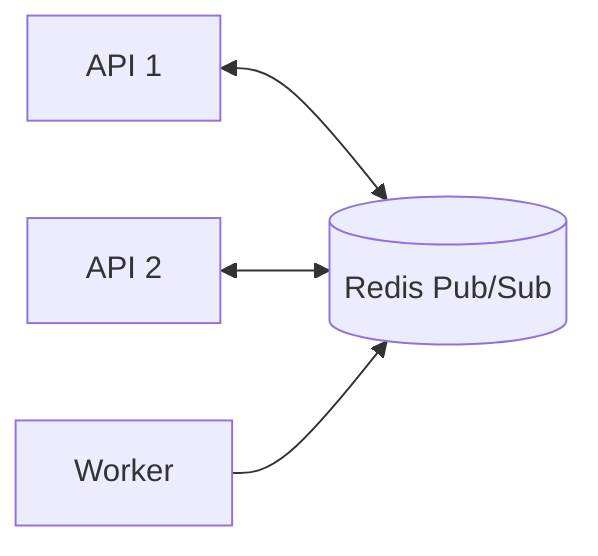

# Escalar WebSockets con el adaptador de Redis

<Tech ids={['socketdotio', 'redis', 'nestjs', 'googlecloud']} />

<Estado tipo="construye">El adaptador de Redis para que las notificaciones lleguen aunque el panel esté conectado a otra instancia de la API.</Estado>

## El problema

Cada instancia de la API tiene **sus propios sockets en memoria**. Con dos instancias:



La instancia 2 emite a la sala `org:alb`, pero el panel está conectado a la 1: **no le llega**.

## La solución: adaptador de Redis

El adaptador publica cada emisión en **Redis Pub/Sub**; todas las instancias
la reciben y la entregan a sus sockets locales.



### En ripopola

```bash
pnpm add -E @socket.io/redis-adapter
```

```ts title="realtime/redis-io.adapter.ts"
import { IoAdapter } from '@nestjs/platform-socket.io';
import { createAdapter } from '@socket.io/redis-adapter';
import { Redis } from 'ioredis';
import type { ServerOptions } from 'socket.io';

export class RedisIoAdapter extends IoAdapter {
  private adapterConstructor?: ReturnType<typeof createAdapter>;

  async connectToRedis(url: string) {
    const pub = new Redis(url);
    const sub = pub.duplicate();
    this.adapterConstructor = createAdapter(pub, sub);
  }

  override createIOServer(port: number, options?: ServerOptions) {
    const server = super.createIOServer(port, options);
    server.adapter(this.adapterConstructor);
    return server;
  }
}
```

```ts title="main.ts"
const redisAdapter = new RedisIoAdapter(app);
await redisAdapter.connectToRedis(config.getOrThrow('REDIS_URL'));
app.useWebSocketAdapter(redisAdapter);
```

Es el patrón que documenta Nest en su capítulo de adaptadores. El código de
los gateways **no cambia**.

## Sesión afín (sticky sessions)

Si el cliente usa el *fallback* de long-polling, cada petición HTTP de una
misma sesión tiene que llegar **a la misma instancia**. En Cloud Run se
activa **session affinity** en el servicio. Con WebSocket puro (el cliente
configurado con `transports: ['websocket']`) no hace falta, porque es una sola conexión.

:::warning Cloud Run y conexiones largas
Cloud Run admite WebSockets, pero cada conexión cuenta como una petición en
curso y tiene un **timeout máximo** (configurable, hasta 60 minutos):
Socket.IO reconecta solo al cortarse. Tené en cuenta también que con
conexiones abiertas la instancia no escala a cero.
:::

## Alternativas

<Alternativa title="Adaptador ws nativo (@nestjs/platform-ws)">

Nest también trae `WsAdapter` con la librería **ws**: WebSocket estándar,
más liviano y rápido, sin el protocolo propio de Socket.IO. A cambio no hay
salas, reconexión, acks ni adaptadores para escalar: se programan a mano.
Útil cuando el cliente no es Socket.IO (por ejemplo, dispositivos o
clientes que hablan WebSocket puro). Para ripopola, Socket.IO.

</Alternativa>

<Alternativa title="Servicios gestionados">

**Firebase Realtime Database / Firestore** (escuchar cambios desde el front),
**Ably**, **Pusher** o **Supabase Realtime** resuelven el tiempo real sin
mantener sockets propios. Menos control y costo por mensaje. Interesante
saber que existen: con Firestore, el panel podría escuchar notificaciones
sin pasar por la API.

</Alternativa>

<Resumen>

- Cada instancia tiene sus sockets: sin adaptador, los mensajes no cruzan.
- Adaptador de Redis (Pub/Sub) con `IoAdapter` y `useWebSocketAdapter`.
- Session affinity para long-polling; timeouts de conexión en Cloud Run.
- `ws` nativo si no necesitás lo que agrega Socket.IO.

</Resumen>

## Preguntas de entrevista

**1. ¿Por qué los WebSockets no escalan horizontalmente "solos"?**
Porque cada conexión vive en una instancia, y un mensaje emitido en otra no llega. Hace falta un bus compartido (Redis Pub/Sub) entre instancias.

**2. ¿Qué son las sticky sessions y cuándo las necesitás?**
Que todas las peticiones de un cliente vayan a la misma instancia. Socket.IO las necesita con transporte long-polling.

**3. ¿Socket.IO o `ws`?**
Socket.IO por funcionalidad (salas, reconexión, acks, escalado). `ws` por rendimiento y compatibilidad con clientes WebSocket estándar.
