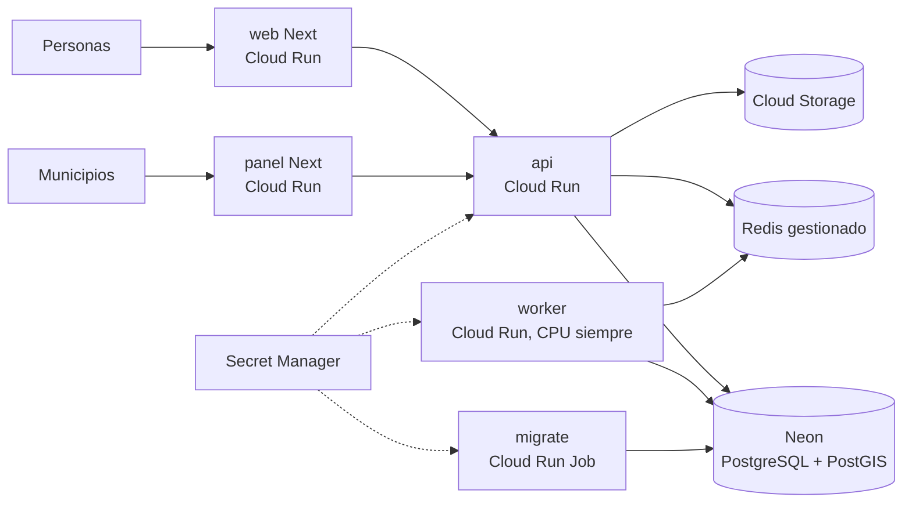

# Desplegar en Cloud Run

<Tech ids={['googlecloud', 'docker', 'nestjs', 'redis', 'nextdotjs', 'vercel']} />

<Estado tipo="construye">La API, el worker, la web con SSR y el panel de ripopola corriendo en Google Cloud, con secretos gestionados y migraciones antes de cada versión.</Estado>

## Concepto

**Cloud Run** corre contenedores sin administrar servidores: le das una
imagen, escala de cero a N instancias según el tráfico y cobra por uso. Lo
que tenés que entender como backend:

- Las instancias son **efímeras y sin estado**: el disco no persiste y
  pueden morir en cualquier momento (de ahí Cloud Storage, Redis y la base).
- Una **revisión** es una versión inmutable (imagen + configuración). El
  tráfico se puede repartir entre revisiones (*canary*, *rollback* en un clic).
- **Concurrencia**: cuántas peticiones atiende una instancia a la vez. Node
  maneja muchas, así que el valor por defecto (80) suele ir bien.
- **Arranque en frío**: con mínimo de instancias en 0, la primera petición
  espera que la instancia arranque. Por eso importa que Nest inicie rápido.

## El mapa de ripopola en producción



## En ripopola

### 1. Preparar el proyecto de Google Cloud (una vez)

```bash
gcloud config set project ripopola-prod
gcloud services enable run.googleapis.com artifactregistry.googleapis.com \
  secretmanager.googleapis.com
gcloud artifacts repositories create ripopola --repository-format=docker \
  --location=europe-southwest1
```

Elegí **una región en Europa** (Madrid es `europe-southwest1`, Milán
`europe-west8`) y usá la misma para todo.

### 2. Una cuenta de servicio con lo mínimo

```bash
gcloud iam service-accounts create ripopola-api
# Leer secretos y escribir en el bucket de imágenes; nada más
gcloud projects add-iam-policy-binding ripopola-prod \
  --member=serviceAccount:ripopola-api@ripopola-prod.iam.gserviceaccount.com \
  --role=roles/secretmanager.secretAccessor
```

Con la cuenta de servicio asignada al servicio, el SDK de Cloud Storage
**se autentica solo** (*Application Default Credentials*):
no hay archivo de credenciales en la imagen. Es el principio de **mínimo
privilegio** de la sección de seguridad.

### 3. Secretos en Secret Manager

```bash
printf '%s' "$DATABASE_URL" | gcloud secrets create DATABASE_URL --data-file=-
printf '%s' "$REDIS_URL"    | gcloud secrets create REDIS_URL    --data-file=-
printf '%s' "$AI_API_KEY"   | gcloud secrets create AI_API_KEY   --data-file=-
printf '%s' "$BETTER_AUTH_SECRET"   | gcloud secrets create BETTER_AUTH_SECRET   --data-file=-
printf '%s' "$GOOGLE_CLIENT_SECRET" | gcloud secrets create GOOGLE_CLIENT_SECRET --data-file=-
```

Cloud Run los inyecta como **variables de entorno**. La app no cambia: el
`ConfigModule` con validación (sección 5) los lee igual y **falla al
arrancar** si falta alguno. Así un error de configuración nunca llega a
recibir tráfico.

### 4. Subir la imagen y desplegar la API

```bash
IMAGE=europe-southwest1-docker.pkg.dev/ripopola-prod/ripopola/api:$(git rev-parse --short HEAD)
docker build -f apps/api/Dockerfile -t $IMAGE . && docker push $IMAGE

gcloud run deploy api --image=$IMAGE --region=europe-southwest1 \
  --service-account=ripopola-api@ripopola-prod.iam.gserviceaccount.com \
  --set-secrets=DATABASE_URL=DATABASE_URL:latest,REDIS_URL=REDIS_URL:latest,AI_API_KEY=AI_API_KEY:latest,BETTER_AUTH_SECRET=BETTER_AUTH_SECRET:latest,GOOGLE_CLIENT_SECRET=GOOGLE_CLIENT_SECRET:latest \
  --set-env-vars='^;^NODE_ENV=production;CORS_ORIGINS=https://ripopola.com,https://panel.ripopola.com;BETTER_AUTH_URL=https://api.ripopola.com;COOKIE_DOMAIN=ripopola.com;GOOGLE_CLIENT_ID=…' \
  --min-instances=0 --max-instances=5 --concurrency=80 --memory=512Mi \
  --session-affinity --timeout=3600 --allow-unauthenticated
```

Qué mirar:

- La etiqueta de la imagen es el **commit**, no `latest`: sabés qué código
  corre y podés volver atrás.
- `--max-instances` también protege la base: 5 instancias × pool de 10 = 50
  conexiones como máximo (sección 11).
- `--session-affinity` y `--timeout=3600` son por los WebSockets (sección 13).
- `^;^` al principio de `--set-env-vars` cambia el separador a `;`, porque
  `CORS_ORIGINS` lleva comas adentro.
- `--allow-unauthenticated` porque la API es pública; la autenticación la
  hace la propia API con Better Auth (sección 6).

### 5. Migraciones como Cloud Run Job

Un **Job** corre un contenedor hasta que termina, sin servir HTTP. Ideal
para `prisma migrate deploy`:

```bash
gcloud run jobs deploy migrate --image=$IMAGE_MIGRATE --region=europe-southwest1 \
  --set-secrets=DIRECT_DATABASE_URL=DIRECT_DATABASE_URL:latest \
  --command=pnpm --args=prisma,migrate,deploy
gcloud run jobs execute migrate --wait
```

La imagen de migración tiene el CLI de Prisma, `prisma.config.ts` y la
carpeta `migrations/` (puede ser la etapa `build` del Dockerfile con
`--target build`). El orden de un despliegue queda:

1. Construir y subir las imágenes.
2. Ejecutar el job `migrate` y **esperar** que termine bien.
3. Desplegar la API y el worker. Si el paso 2 falla, no se despliega nada.

:::warning No migrar al arrancar la API
Correr `migrate deploy` en el `main.ts` parece cómodo, pero con varias
instancias arrancando a la vez compiten por migrar, y un fallo deja
instancias en un estado raro. La migración es un **paso separado** del
despliegue.
:::

### 6. Sondas de salud

Los endpoints de Terminus (sección 9) se conectan a las sondas de Cloud Run:

- **Startup probe** → `/health/live`: la instancia no recibe tráfico hasta que responda.
- **Liveness probe** → `/health/live`: si deja de responder, Cloud Run la reinicia.

Se configuran en el YAML del servicio (`gcloud run services replace
service.yaml`) o en la consola. El `ready` con base y Redis queda para
monitoreo y alertas: si la base cae, reiniciar instancias no lo arregla.

### 7. El worker de BullMQ

Lo adelantamos en la sección 10: Cloud Run, por defecto, da CPU **solo
mientras atiende peticiones**. Un worker escucha la cola todo el tiempo.

```bash
gcloud run deploy worker --image=$IMAGE --region=europe-southwest1 \
  --command=node --args=worker.js \
  --no-cpu-throttling --min-instances=1 --max-instances=2 \
  --no-allow-unauthenticated --set-secrets=...
```

- **Misma imagen**, otro punto de entrada (`worker.js` con
  `NestFactory.createApplicationContext`).
- `--no-cpu-throttling`: **CPU siempre asignada** (se cobra todo el tiempo).
- `--min-instances=1`: siempre hay alguien procesando.
- Sin acceso público. Como Cloud Run espera que el contenedor escuche en
  `PORT`, el worker levanta un HTTP mínimo con `/health/live`.

:::info Decisión pendiente: costo del worker
Una instancia siempre encendida es el mayor costo fijo de ripopola al
empezar. Mientras el volumen sea bajo, una alternativa es procesar dentro
de la API con `--no-cpu-throttling` y `--min-instances=1` en un solo
servicio. Documentalo como ADR (sección 15) y revisalo cuando crezca el tráfico.
:::

### 8. Redis gestionado

La decisión del proveedor de Redis se toma al desplegar. Los criterios que
tiene que cumplir, por lo que vimos en las secciones 10 a 13:

| Requisito | Por qué |
| --- | --- |
| `maxmemory-policy noeviction` configurable | BullMQ lo exige |
| Persistencia | Que los trabajos no se pierdan |
| Conexiones largas (TCP) y Pub/Sub | BullMQ y el adaptador de Socket.IO |
| Misma región | Latencia |
| TLS (`rediss://`) | Tráfico por internet |

Candidatas: **Memorystore** (Google, red privada, más caro y sin plan
chico), **Redis Cloud** o **Upstash** (planes chicos o gratis; en Upstash,
revisá que el plan admita la carga de conexiones de BullMQ). Valkey es
compatible si el proveedor lo ofrece.

### 9. La web y el panel (Next.js)

Las dos apps de Next **no son estáticas**: renderizan en el servidor,
reenvían cookies y cachean (sección 12). Necesitan un servidor Node. Tres
opciones reales:

| | Cloud Run (recomendada) | Vercel | Firebase App Hosting |
| --- | --- | --- | --- |
| Qué es | Tu contenedor con `next start` | La plataforma de los creadores de Next | Next gestionado por Google (corre sobre Cloud Run) |
| Soporte de Next | Todo, configurándolo vos | Todo, sin configurar (caché, imágenes, previews) | Casi todo, con su adaptador |
| Caché compartida entre instancias | La armás vos (`cacheHandlers` + Redis) | Incluida | Gestionada por la plataforma |
| Llamar a la API por red interna | Sí, mismo proyecto | No: por internet | Sí, mismo proyecto |
| Costo | Por uso, igual que la API | Plan gratuito chico; equipos pagan por usuario | Por uso de Cloud Run y CDN |
| Previews por pull request | A mano | Automáticas | Por rama |

Para ripopola, **Cloud Run** deja todo en el mismo proyecto, región y
facturación, y la web llama a la API sin salir de Google. **Vercel** es la
alternativa más usada del mercado para Next y la más cómoda: si el costo y
la caché compartida en Cloud Run se complican, es el plan B. Registralo
como ADR (sección 15).

#### Next en un contenedor

```ts title="apps/web/next.config.ts"
const nextConfig: NextConfig = {
  output: 'standalone',          // un server.js con solo las dependencias que usa
  cacheComponents: true,
  partialPrefetching: true,
  // cacheHandlers: { default: require.resolve('./cache-handler.mjs') },  // Redis, ver abajo
};
```

```dockerfile title="apps/web/Dockerfile (resumen)"
FROM node:26-alpine AS build
# ... instalar y pnpm nx build web (igual que la API, tema 1)

FROM node:26-alpine AS runtime
ENV NODE_ENV=production PORT=8080 HOSTNAME=0.0.0.0
WORKDIR /app
COPY --from=build /repo/apps/web/.next/standalone ./
COPY --from=build /repo/apps/web/.next/static ./apps/web/.next/static
COPY --from=build /repo/apps/web/public ./apps/web/public
USER node
CMD ["node", "apps/web/server.js"]
```

En un monorepo, `standalone` replica la estructura de carpetas desde la
raíz: el `server.js` queda en `apps/web/` dentro de `standalone`. Revisá la
ruta exacta en tu build. `static` y `public` se copian aparte (o se sirven
desde una CDN).

#### Tres trampas de Next en producción

- **`NEXT_PUBLIC_*` se fija en el build**: el valor queda escrito en el
  JavaScript. Si la misma imagen va a staging y a producción, la URL pública
  de la API no puede depender de una `NEXT_PUBLIC_*`; o construís una imagen
  por entorno, o el navegador usa rutas relativas (`/api/...`) con rewrites.
- **Caché por instancia**: con `--max-instances` mayor a 1, cada instancia
  tiene su caché y la revalidación de Nest llega a una sola (sección 12).
  Configurá un `cacheHandlers` con Redis (el mismo servicio gestionado del
  paso 8, con otro prefijo) o usá una sola instancia al principio.
- **El servidor de Next también escala a cero**: el primer visitante de la
  mañana espera el arranque. Para la web pública, `--min-instances=1`.

:::warning Cookies de sesión y dominios
La sesión de Better Auth es una cookie (sección 6). Para que la compartan
`ripopola.com` (web), `panel.ripopola.com` y `api.ripopola.com`, la API la
emite para el dominio `ripopola.com` (`COOKIE_DOMAIN`, opción
`crossSubDomainCookies`). Al ser el **mismo sitio**, `SameSite=Lax` sigue
funcionando y el servidor de Next recibe la cookie para reenviarla a la API.

Lo que rompe esto:

- **Dominios de previews** (`ripopola-git-rama.vercel.app`, `*.run.app`):
  son otro sitio, la cookie de `ripopola.com` no llega. En previews, el
  navegador tiene que hablar con la API a través de los `rewrites` de Next
  (mismo origen); en ese entorno la API no fija `COOKIE_DOMAIN` y acepta el
  origen de la preview en `trustedOrigins`.
- **Rewrites de Firebase Hosting hacia Cloud Run**: solo reenvían una cookie
  llamada `__session`. No sirven para la sesión de Better Auth.
- **La web y la API en dominios distintos** (`ripopola.com` y
  `ripopola-api.com`): son sitios distintos; las cookies `SameSite=Lax` no
  viajan y habría que pasar a `SameSite=None`, con más riesgo de CSRF. Mantené
  todo bajo el mismo dominio.
:::

### 10. Dominios y HTTPS

Cloud Run y el balanceador dan certificados HTTPS automáticos. Para
dominios propios (`ripopola.com`, `api.ripopola.com`), un **balanceador de
carga** delante de Cloud Run es la opción robusta (y permite Cloud CDN y
Cloud Armor); el mapeo de dominios directo de Cloud Run sirve para empezar.
Detrás de cualquier proxy, recordá `trust proxy` (sección 9).

<Alternativa title="Render, Railway, Fly.io">

**Render** (el que usa el curso de referencia), **Railway** y **Fly.io**
despliegan desde Git o Docker con menos configuración, y son muy usados
para proyectos chicos y medianos. A cambio, tenés menos servicios
alrededor (Secret Manager, IAM, Cloud Storage en el mismo proyecto). Como
ripopola ya usa Cloud Storage, Cloud Run deja todo en un mismo lugar. Con Docker, mudarse a cualquiera de ellos es posible.

</Alternativa>

<Alternativa title="Kubernetes (GKE)">

Kubernetes es el estándar para flotas grandes de servicios y aparece mucho
en entrevistas. Para ripopola sería sobredimensionado: Cloud Run usa el
mismo modelo de contenedores (de hecho es compatible con Knative) sin
administrar el clúster. Conviene saber los conceptos: Pod, Deployment,
Service, Ingress, ConfigMap, Secret y HPA.

</Alternativa>

<Resumen>

- Cloud Run: contenedores sin estado, revisiones inmutables, escala a cero.
- Cuenta de servicio con mínimo privilegio y secretos en Secret Manager.
- Imagen etiquetada por commit; `migrate deploy` en un Job antes de desplegar.
- Sondas a Terminus; worker con CPU siempre asignada; Redis con `noeviction`.
- web y panel en Next sobre Cloud Run (Vercel como alternativa); caché compartida y cookie de sesión para `ripopola.com`.

</Resumen>

## Preguntas de entrevista

**1. ¿Qué implica que un servicio sea *stateless*?**
Que ninguna instancia guarda datos que otra necesite: archivos en un storage, sesiones y colas en Redis, datos en la base. Así se puede escalar, reiniciar o reemplazar cualquier instancia.

**2. ¿Cómo ejecutás migraciones en un despliegue?**
Como un paso separado (un job) que corre antes de desplegar el código nuevo, con migraciones compatibles con la versión anterior, y que corta el despliegue si falla.

**3. ¿Cómo hacés un rollback en Cloud Run?**
Mandando el tráfico a la revisión anterior, que sigue existiendo. Por eso las migraciones tienen que ser compatibles hacia atrás.

**4. ¿Qué es un arranque en frío y cómo lo mitigás?**
La demora de la primera petición mientras arranca una instancia nueva. Se mitiga con instancias mínimas, imágenes chicas y un arranque rápido de la app.

**5. ¿Dónde guardás los secretos?**
En un gestor de secretos (Secret Manager) inyectado como variables de entorno en runtime, con acceso solo para la cuenta de servicio que los necesita. Nunca en el repo ni en la imagen.

**6. ¿Qué cambia al desplegar Next.js en tu propia infraestructura en vez de en Vercel?**
Tenés que resolver vos la caché compartida entre instancias (un cache handler con Redis), servir los estáticos (CDN), las previews y tener en cuenta que las variables `NEXT_PUBLIC_*` se fijan en el build. A cambio, todo queda en tu nube y con tus costos.
