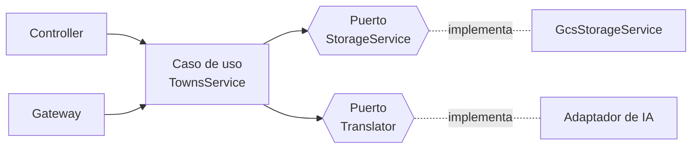

# Capas, arquitectura hexagonal y DDD

<Tech ids={['nestjs', 'prisma', 'typescript']} />

<Estado tipo="concepto">Ripopola ya usa varias de estas ideas (StorageService, el adaptador de IA, el lenguaje del dominio). Acá se les pone nombre y se discute hasta dónde llevarlas.</Estado>

## Capas: quién hace qué

| Capa | En Nest | Responsabilidad | No debería |
| --- | --- | --- | --- |
| Entrada | Controller, Gateway, Processor | Traducir HTTP / socket / trabajo a una llamada | Tener reglas de negocio |
| Aplicación | Service (caso de uso) | Orquestar: validar permisos, reglas, transacción, eventos | Saber de HTTP |
| Dominio | Funciones y tipos puros | Las reglas del negocio | Saber de Prisma o de Nest |
| Infraestructura | Repositorio, clientes externos | Hablar con la base, Redis, APIs | Decidir reglas |

<Angular>

Es la misma separación que hacés en Angular entre componente
(presentación), servicio de estado (orquestación) y servicio de datos
(`HttpClient`). Un componente que llama directo a `HttpClient` y decide
reglas es el equivalente a un controlador con lógica de negocio.

</Angular>

## Arquitectura hexagonal (puertos y adaptadores)

La idea: **el núcleo no depende de la infraestructura; la infraestructura
depende del núcleo**. El núcleo define un **puerto** (una interfaz o clase
abstracta) y la infraestructura provee un **adaptador**.

Ya lo hiciste dos veces en ripopola:

```ts
// Puerto (sección 7)
export abstract class StorageService {
  abstract upload(key: string, data: Buffer, contentType: string): Promise<string>;
}
// Adaptador
@Injectable() export class GcsStorageService extends StorageService { /* ... */ }
// Cableado
{ provide: StorageService, useClass: GcsStorageService }
```

Y con el adaptador de IA de traducciones (sección 5). La ventaja se ve en
los tests (un adaptador falso en memoria) y al cambiar de proveedor sin
tocar los casos de uso.



:::tip ¿Y Prisma?
Esconder Prisma detrás de un repositorio abstracto **en todos los
módulos** suele ser exceso: Prisma ya es una abstracción tipada, y el
repositorio termina copiando su API. En ripopola se aísla donde aporta:
el SQL de PostGIS en `TownGeoRepository` (sección 4). Para el resto, el
servicio usa `PrismaService` directamente. Saber justificar este punto
medio es más senior que aplicar el patrón en todos lados.
:::

## Domain-Driven Design, lo que sirve

DDD es un enfoque para modelar dominios complejos. De su caja de
herramientas, lo que ripopola aprovecha:

- **Lenguaje ubicuo**: los nombres del código son los del negocio
  (*pueblo*, *municipio*, *anuncio de vivienda*, *publicar*, *reclamar el
  pueblo*). Si el ayuntamiento dice "reclamar", el método es `claimTown`,
  no `assignOwner`.
- **Contextos delimitados** (*bounded contexts*): "pueblo" no significa lo
  mismo para el catálogo público (ficha, fotos, clima) que para la
  facturación de suscripciones (un cliente). Cada módulo tiene su modelo.
- **Agregado**: un grupo de objetos que se modifica junto y protege sus
  reglas. Un `HousingListing` con sus fotos: las fotos no se editan por
  fuera del anuncio.
- **Invariantes en un solo lugar**: "un pueblo solo se publica si tiene
  nombre, descripción y al menos una foto" vive en una función del
  dominio, no repartido entre controlador, servicio y front.
- **Eventos de dominio**: `TownPublishedEvent`, ya implementado.

```ts title="towns/domain/town.rules.ts"
export function assertPublishable(town: { name: string; description: string | null; mediaCount: number }) {
  const missing: string[] = [];
  if (!town.description?.trim()) missing.push('description');
  if (town.mediaCount === 0) missing.push('media');
  if (missing.length) throw new TownNotPublishableError(missing);
}
```

Función pura, sin Nest ni Prisma: se prueba en milisegundos y el servicio
la llama antes de publicar. El filtro de errores (sección 8) traduce
`TownNotPublishableError` a un Problem Details 422.

<Alternativa title="Clean Architecture y DDD táctico completo">

**Clean Architecture** (Uncle Bob) y **Onion** son variantes de la misma
idea que la hexagonal: dependencias hacia adentro. El **DDD táctico
completo** (entidades ricas, value objects para todo, repositorios por
agregado, factories) se ve mucho en proyectos Nest empresariales y en
entrevistas. Vale la pena cuando el dominio es complejo; en un CRUD con
algunas reglas agrega mucha ceremonia. Ripopola toma las ideas y no la
ceremonia.

</Alternativa>

<Ejercicio title="Sacá una regla al dominio">

Buscá en `HousingService` una regla de negocio (por ejemplo, que un anuncio
no pueda tener precio negativo ni más de 30 fotos) y movela a una función
pura en `housing/domain/`. Escribile tests unitarios sin `Test.createTestingModule`.

</Ejercicio>

<Resumen>

- Capas: entrada traduce, aplicación orquesta, dominio decide, infraestructura habla con afuera.
- Hexagonal: el núcleo define puertos, la infraestructura los implementa (StorageService, IA).
- DDD útil: lenguaje ubicuo, contextos, agregados, invariantes y eventos.
- Abstraer donde aporta (PostGIS, proveedores externos), no por reflejo.

</Resumen>

## Preguntas de entrevista

**1. ¿Qué es la arquitectura hexagonal?**
Separar el núcleo de la aplicación de los detalles externos mediante puertos (interfaces que define el núcleo) y adaptadores (implementaciones de infraestructura), de forma que las dependencias apunten hacia el núcleo.

**2. ¿Envolverías Prisma en repositorios?**
Donde aporta: SQL complejo, un modelo que no coincide con las tablas o la necesidad de cambiar la persistencia. Envolver todo por defecto duplica la API de Prisma sin beneficio.

**3. ¿Qué es un bounded context?**
Un límite dentro del cual un modelo y su lenguaje tienen un significado preciso. El mismo concepto puede modelarse distinto en contextos distintos.

**4. ¿Dónde ponés una regla de negocio en Nest?**
En el dominio o en el servicio de aplicación, nunca en el controlador. Idealmente en una función o clase pura que se pueda probar sin el framework.
